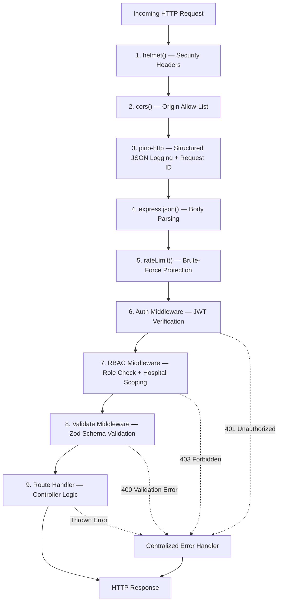
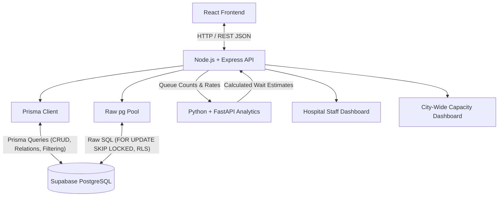
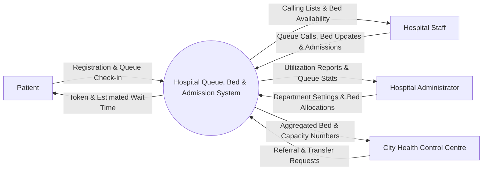
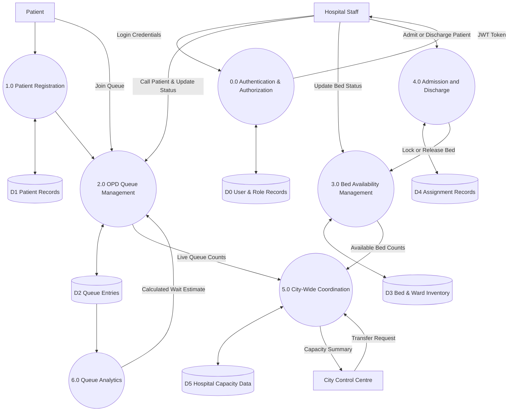
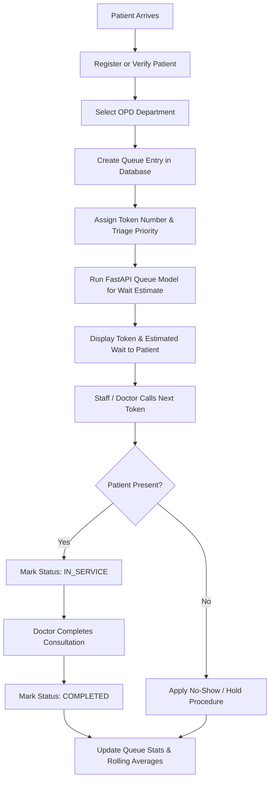
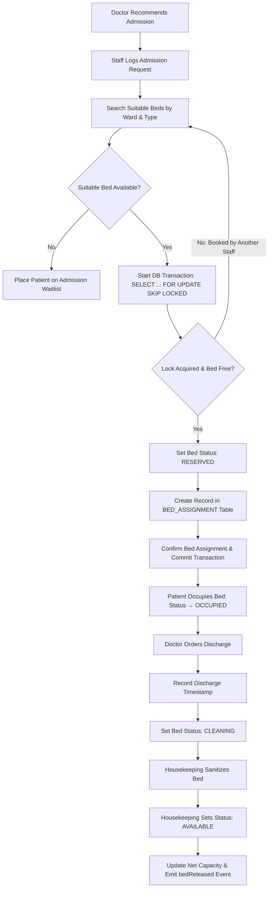
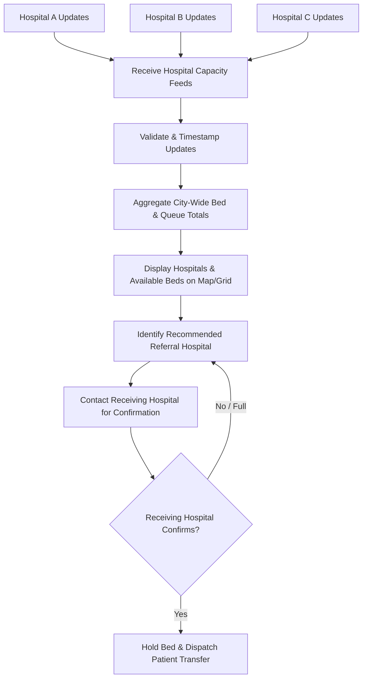
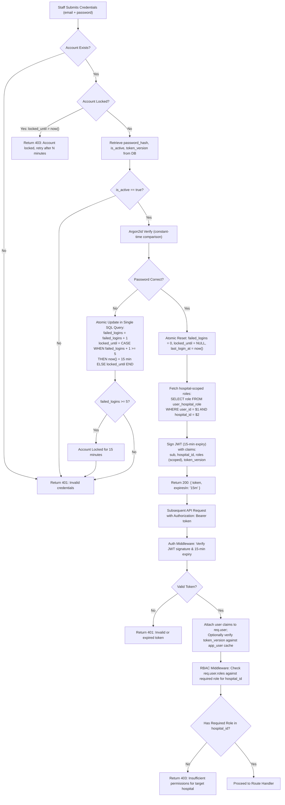

# Proposal: Hospital Patient Queue, Bed Availability & Admission Management System

## Project Overview

Hospitals deal with two major operational headaches every day: overcrowded OPD waiting areas and chaotic, delayed bed allocations during admissions. This proposal outlines a practical, real-time management system designed to tackle both issues head-on.

The system manages outpatient (OPD) queues, tracks live bed availability, and handles patient admissions and discharges. It is designed to work smoothly within a single hospital first, while having the architecture ready to expand into a city-wide coordination dashboard where multiple hospitals can view each other's live capacity.

This proposal provides the four requested deliverables:

1. **ER diagram for the solution** — the relational data model, entity breakdown, and integrity rules.
2. **Tech stack** — the frameworks, ORM, database, and middleware architecture to be used, including system communication and queueing calculations.
3. **Data flow diagrams (DFDs)** — context (Level 0), system decomposition (Level 1), and detailed operational workflows (Level 2).
4. **Authentication & authorization design** — user registration, login, JWT-based access control, and role-based hospital scoping.

The proposed stack uses **React, JavaScript, HTML, CSS, Node.js (Express), Prisma ORM, Python (FastAPI), and Supabase PostgreSQL**.

---

# 1. ER Diagram for the Solution

The database needs to handle high-frequency queue updates, strict race-condition-free bed assignments, secure user authentication with lockout protection, and tamper-proof audit logging. We use **Supabase PostgreSQL** as our relational database because we need ACID transactions, foreign-key constraints, row-level security (RLS), and database-level concurrency controls to guarantee correctness under simultaneous access.

### Entity Relationship Diagram

#### Visual Schema & Relationship Map (Universal Text View)

```text
+-------------------+          +------------------------+          +-------------------------+
|       CITY        |          |        HOSPITAL        |          |       DEPARTMENT        |
+-------------------+          +------------------------+          +-------------------------+
| * city_id    (PK) | 1      * | * hospital_id     (PK) | 1      * | * department_id    (PK) |
|   name            | -------- |   city_id         (FK) | -------- |   hospital_id      (FK) |
+-------------------+ contains |   name                 |   has    |   name                  |
                               |   address              |          |   UNIQUE(hosp_id, name) |
                               |   hospital_type        |          +-------------------------+
                               |   created_at           |                       |
                               +------------------------+                       | 1
                                  | 1       | 1      | 1                        | operates
                                  |         |        |                          | *
                                  |         |        |             +-------------------------+
                                  |         |        |             |        OPD_QUEUE        |
                                  |         |        |             +-------------------------+
                                  |         |        |             | * queue_id         (PK) |
                                  |         |        |             |   department_id    (FK) |
                                  |         |        |             |   queue_date            |
                                  |         |        |             |   status                |
                                  v *       |        v *           +-------------------------+
+-------------------+           |      +------------------------+              |
|     APP_USER      |           |      |          WARD          |              | 1
+-------------------+           |      +------------------------+              | contains
| * user_id    (PK) |           |      | * ward_id         (PK) |              | *
|   email (UNIQUE)  |           |      |   hospital_id     (FK) |              v
|   full_name       |           |      |   department_id   (FK) |   +-------------------------+
|   password_hash   |           |      |   name                 |   |       QUEUE_ENTRY       |
|   is_active       |           |      |   code (UNIQUE/hosp)   |   +-------------------------+
|   failed_logins   |           |      |   type (ward_type)     |   | * entry_id         (PK) |
|   locked_until    |           |      |   floor_number         |   |   queue_id         (FK) |
|   last_login_at   |           |      |   capacity             |   |   patient_id       (FK) |
|   created_at      |           |      +------------------------+   |   token_number          |
+-------------------+           |                  |                |   priority              |
        | 1                     |                  | 1              |   status                |
        | has_roles             |                  | holds          |   joined_at             |
        | *                     |                  | *              +-------------------------+
+-------------------------+     |      +------------------------+
| USER_HOSPITAL_ROLE      |     |      |          BED           |
+-------------------------+     |      +------------------------+
| * user_id       (FK,PK) |     |      | * bed_id          (PK) |
| * hospital_id   (FK,PK) |     |      |   hospital_id     (FK) |
| * role          (PK)    |     |      |   ward_id         (FK) |
|   department_id (FK)    |     |      |   bed_number           |
+-------------------------+     |      |   status (bed_status)  |
                                |      |   is_isolation         |
                                |      |   reserved_until       |
+-------------------+           |      +------------------------+
|      PATIENT      |           |                  |
+-------------------+           |                  | 1
| * patient_id (PK) |           |                  | assigned_to
|   hospital_id(FK) |           |                  | *
|   uhid (UNIQUE)   |           |      +-------------------------------------+
|   full_name       |           |      |           BED_ASSIGNMENT             |
|   date_of_birth   |           |      +-------------------------------------+
|   sex             |           |      | * assignment_id              (PK)   |
|   phone_e164      |           |      |   hospital_id               (FK)   |
|   merged_into(FK) |           |      |   bed_id                    (FK)   |
|   created_at      |           |      |   patient_id                (FK)   |
|   created_by (FK) |           |      |   assigned_by               (FK)   |
+-------------------+           |      |   status (assignment_status)       |
        |                       |      |   assigned_at                      |
        | joins                 |      |   discharged_at                    |
        +------- QUEUE_ENTRY    |      |   notes                            |
        | receives              |      +-------------------------------------+
        +------- BED_ASSIGNMENT |
                                |
+-------------------------------+------+
|            AUDIT_LOG                 |
+--------------------------------------+
| * audit_id  (PK, IDENTITY)          |
|   at                                 |
|   actor_user_id (FK)                 |
|   hospital_id                        |
|   action                             |
|   entity_type                        |
|   entity_id                          |
|   before  (JSONB)                    |
|   after   (JSONB)                    |
|   request_id                         |
+--------------------------------------+

+--------------------------------------+
|         IDEMPOTENCY_KEY              |
+--------------------------------------+
| * key        (PK, UUID)             |
|   user_id                            |
|   request_hash                       |
|   response   (JSONB)                 |
|   created_at                         |
+--------------------------------------+
```

#### Mermaid Source Code (for Mermaid-enabled viewers)

```mermaid
erDiagram
    CITY ||--o{ HOSPITAL : contains
    HOSPITAL ||--o{ DEPARTMENT : has
    HOSPITAL ||--o{ WARD : manages
    HOSPITAL ||--o{ BED : owns
    HOSPITAL ||--o{ PATIENT : registers
    HOSPITAL ||--o{ APP_USER : "employs (via role)"
    DEPARTMENT ||--o{ OPD_QUEUE : operates
    DEPARTMENT ||--o{ WARD : "may contain"
    WARD ||--o{ BED : holds
    PATIENT ||--o{ QUEUE_ENTRY : joins
    OPD_QUEUE ||--o{ QUEUE_ENTRY : contains
    PATIENT ||--o{ BED_ASSIGNMENT : receives
    BED ||--o{ BED_ASSIGNMENT : assigned_to
    APP_USER ||--o{ USER_HOSPITAL_ROLE : has_roles
    APP_USER ||--o{ BED_ASSIGNMENT : assigns
    APP_USER ||--o{ PATIENT : creates
    APP_USER ||--o{ AUDIT_LOG : performs

    CITY {
        uuid city_id PK
        text name UK
    }

    HOSPITAL {
        uuid hospital_id PK
        uuid city_id FK
        text name
        text address
        text hospital_type
        timestamptz created_at
    }

    DEPARTMENT {
        uuid department_id PK
        uuid hospital_id FK
        text name
    }

    APP_USER {
        uuid user_id PK
        citext email UK
        text full_name
        text password_hash
        boolean is_active
        int failed_logins
        timestamptz locked_until
        timestamptz last_login_at
        int token_version
        timestamptz created_at
    }

    USER_HOSPITAL_ROLE {
        uuid user_id PK_FK
        uuid hospital_id PK_FK
        user_role role PK
        uuid department_id FK
    }

    PATIENT {
        uuid patient_id PK
        uuid hospital_id FK
        text uhid UK
        text full_name
        date date_of_birth
        text sex
        text phone_e164
        uuid merged_into FK
        timestamptz created_at
        uuid created_by FK
    }

    WARD {
        uuid ward_id PK
        uuid hospital_id FK
        uuid department_id FK
        text name
        text code UK
        ward_type type
        int floor_number
        int capacity
        timestamptz created_at
        timestamptz updated_at
    }

    BED {
        uuid bed_id PK
        uuid hospital_id FK_UK
        uuid ward_id FK
        text bed_number
        bed_status status
        boolean is_isolation
        timestamptz reserved_until
        timestamptz created_at
        timestamptz updated_at
    }

    OPD_QUEUE {
        uuid queue_id PK
        uuid department_id FK
        date queue_date
        text status
    }

    QUEUE_ENTRY {
        uuid entry_id PK
        uuid queue_id FK
        uuid patient_id FK
        int token_number
        int priority
        text status
        timestamptz joined_at
    }

    BED_ASSIGNMENT {
        uuid assignment_id PK
        uuid hospital_id FK
        uuid bed_id FK
        uuid patient_id FK
        uuid assigned_by FK
        assignment_status status
        timestamptz assigned_at
        timestamptz discharged_at
        text notes
    }

    AUDIT_LOG {
        bigint audit_id PK
        timestamptz at
        uuid actor_user_id FK
        uuid hospital_id
        text action
        text entity_type
        text entity_id
        jsonb before
        jsonb after
        uuid request_id
    }

    IDEMPOTENCY_KEY {
        uuid key PK_UK
        uuid user_id FK_UK
        text method UK
        text route UK
        uuid hospital_id UK
        text request_hash
        jsonb response
        timestamptz created_at
    }
```

### Entities and Their Purpose

| Entity | Purpose |
| :--- | :--- |
| `CITY` | Groups hospitals under a regional or city-wide umbrella for coordinated capacity viewing. |
| `HOSPITAL` | Stores essential hospital information such as name, address, and facility type. |
| `DEPARTMENT` | Represents clinical departments (e.g., General Medicine, Cardiology, Orthopaedics) that run outpatient queues and may contain wards. |
| `APP_USER` | Authenticated staff accounts with email login, Argon2id password hashes, lockout counters, and login timestamps. |
| `USER_HOSPITAL_ROLE` | Junction table linking a user to one or more hospitals with a specific role (`FRONT_DESK`, `NURSE`, `DOCTOR`, `HOUSEKEEPING`, `BED_MANAGER`, `HOSPITAL_ADMIN`, `CITY_VIEWER`). A user can hold multiple roles across multiple hospitals. |
| `PATIENT` | Master patient record with a unique hospital ID (UHID), demographics, phone in E.164 format, and support for patient merging (`merged_into`). Tracks who created the record (`created_by`). |
| `WARD` | Physical ward within a hospital, typed (General, ICU, Emergency, Pediatric, Maternity), with a floor number and capacity. Optionally linked to a department. |
| `BED` | Individual bed within a ward, with a status enum tracking its lifecycle and an isolation flag. |
| `OPD_QUEUE` | Represents an active queue session for a specific department on a given day. |
| `QUEUE_ENTRY` | Tracks individual patient tokens, triage priority, check-in timestamps, and queue status within an OPD queue. |
| `BED_ASSIGNMENT` | Inpatient records linking a patient to an allocated bed, tracking who assigned it, admission and discharge timestamps, and assignment status. Partial unique indexes enforce one active assignment per bed and one active assignment per patient. |
| `AUDIT_LOG` | Append-only, tamper-proof log of every state-changing action. Stores before/after JSONB snapshots for forensic review. DML restrictions prevent updates or deletes to this table. |
| `IDEMPOTENCY_KEY` | Prevents duplicate writes from retried API requests. Stored responses are scoped by `(key, user_id, method, route, hospital_id)`, with a composite unique constraint preventing cross-user or cross-route collisions. |

### Key Database & Business Rules

* **One bed, one active patient:** A bed can have many historical assignments over time, but a partial unique index (`WHERE status = 'ACTIVE'`) ensures it can never have two active occupants simultaneously.
* **One active assignment per patient:** A second partial unique index prevents a patient from being assigned to two beds at once.
* **Hospital-scoped bed assignment integrity:** In `BED_ASSIGNMENT`, the assigned `bed_id` and `patient_id` must both belong to the specified `hospital_id`. This is enforced via composite foreign keys (`CONSTRAINT fk_assignment_bed FOREIGN KEY (hospital_id, bed_id) REFERENCES bed(hospital_id, bed_id)`) referencing the unique constraint on `bed` (`CONSTRAINT uq_bed_hospital_id_id UNIQUE (hospital_id, bed_id)` defined in migration `002_ward_bed_assignment.sql`), alongside explicit transactional checks ensuring `patient.hospital_id = bed_assignment.hospital_id`, physically preventing cross-hospital bed allocation.
* **Explicit bed status progression:** Bed status must move through distinct states: `AVAILABLE` → `RESERVED` → `OCCUPIED` → `CLEANING` → `AVAILABLE` (with `OUT_OF_SERVICE` for maintenance). A discharged bed cannot be marked available until housekeeping confirms it has been sanitized.
* **Deterministic queue states:** Queue entries must follow clear transitions: `WAITING` → `CALLED` → `IN_SERVICE` → `COMPLETED` (or `CANCELLED` if the patient leaves or doesn't show up).
* **Concurrency protection:** When reserving a bed, the backend uses atomic database transactions with row-level locks (`SELECT ... FOR UPDATE SKIP LOCKED`) so two staff members cannot assign the same bed simultaneously. This is one of the operations performed via the raw `pg` database driver rather than Prisma, because Prisma's query builder cannot express `FOR UPDATE SKIP LOCKED`.
* **Discharge constraint:** A `CHECK` constraint ensures that `discharged_at` is `NULL` when status is `ACTIVE`, and is non-null and >= `assigned_at` when status is `DISCHARGED` or `TRANSFERRED`.
* **Audit log immutability (planned control):** In scheduled migration `004_roles_and_rls.sql`, database-level DML restrictions (`REVOKE UPDATE, DELETE`) will be applied to `audit_log` for the `api_user` role, ensuring the log is append-only and tamper-proof. (Note: initial migration `001_identity_core.sql` defines the table structure; the permission revocation is scheduled when the non-owner role is provisioned).
* **Idempotency for write operations (pre-claim pattern & composite scoping):** Mutating API endpoints accept an `Idempotency-Key` header. In initial migration `001_identity_core.sql`, `key uuid PRIMARY KEY` establishes the foundation table. In scheduled migration `004_roles_and_rls.sql`, the single-column primary key is dropped and replaced with a composite unique constraint over `(key, user_id, method, route, COALESCE(hospital_id, '00000000-0000-0000-0000-000000000000'::uuid))` so that keys are strictly isolated per user, route, and tenant context. The middleware pre-claims the key with `response = NULL` *before* the handler executes. Concurrent duplicate requests hit the unique constraint and receive a `409 Conflict` while the initial request is in flight; once complete, replays return the cached response. Reusing an existing key with a different `request_hash` returns a deterministic `422 Unprocessable Entity` client error without executing the mutation. The handler's writes and final response payload are committed in a single atomic transaction.
* **City-wide data boundary:** In city-wide mode, each hospital maintains full ownership of its operational records. The city module only reads aggregated capacity and average wait times via a database view, never raw private patient records.
* **Bilateral transfer confirmation:** The city dashboard displays estimated bed availability, but an inter-hospital transfer cannot be confirmed until the receiving facility explicitly accepts the referral.
* **User lockout:** After 5 consecutive failed login attempts, the `app_user.locked_until` timestamp is set 15 minutes in the future. Failed login increments, threshold comparisons, and lockout updates execute atomically in a single SQL operation to prevent race conditions under concurrent requests. Login attempts during lockout are rejected regardless of password correctness.
* **Patient merge pointer and cycle prevention:** When duplicate patient records are discovered, one record's `merged_into` field points to the canonical record. Merge transactions must reject self-links (`patient_id = merged_into`) and atomically traverse the target chain to verify no cycle exists before updating the pointer. If validation fails, the pointer update is aborted and the transaction rolls back. Downstream queries follow this pointer to resolve the canonical active patient.

---

# 2. Tech Stack — Frameworks, ORM & Architecture

We chose a practical dual-backend architecture: **Node.js/Express** with **Prisma ORM** handles core business logic and database operations, while **Python/FastAPI** is dedicated to queueing calculations and analytics. This keeps day-to-day operations fast and isolates heavier statistical math from the main API.

### Technology Choices

* **Frontend: React + JavaScript + HTML + CSS**
  * Builds the responsive patient token screen, doctor calling console, ward bed management view, and the city-wide capacity dashboard.
  * React makes it easy to update queue numbers and bed status badges instantly without page reloads.

* **Main Backend: Node.js + Express**
  * Handles patient registrations, OPD token generation, queue status updates, admissions, discharges, and bed state updates.
  * Express is lightweight and fast with asynchronous I/O. Node.js uses the **V8 JavaScript engine** for compilation and **libuv** for its non-blocking I/O event loop, allowing the server to handle thousands of concurrent connections on a single thread without blocking.
  * **Event-driven architecture:** We use Node's built-in `EventEmitter` for in-process event dispatch. For example, when a bed is released, a `bedReleased` event is emitted, which triggers the waitlist checker to notify the next queued patient. This decouples the discharge logic from the waitlist logic without introducing an external message broker.
  * **Streams:** For audit log exports, we use Node.js `Readable` streams to pipe large result sets directly to the HTTP response without buffering the entire JSON payload in memory. This keeps memory usage constant regardless of log size.
  * The Express server uses Node's **`process` module** for environment variable access (`process.env`), graceful shutdown signal handling (`process.on('SIGTERM', ...)`), and health checks. The **`path` module** is used for resolving migration and static file paths. The **`fs` module** is used for reading seed data files.

* **ORM & Database Access: Prisma + node-pg-migrate (Hybrid)**
  * **Authoritative Schema & Migration Engine (`node-pg-migrate`):** `node-pg-migrate` is the sole owner of database schema history and migration execution (`db/migrations/`). This guarantees that complex PostgreSQL features—such as `citext` extensions, custom enums (`user_role`, `ward_type`, `bed_status`, `assignment_status`), composite foreign keys, partial unique indexes (`WHERE status = 'ACTIVE'`), triggers, and RLS policies—are version-controlled with native SQL precision without migration drift or abstraction friction. Initial migration `001_identity_core.sql` has already been executed against Supabase.
  * **Prisma ORM via Database Introspection (`prisma db pull`):** Rather than running `prisma migrate dev` against the database (which would conflict with `node-pg-migrate`), Prisma integrates via introspection. Running `npx prisma db pull` reads the live PostgreSQL tables and generates `prisma/schema.prisma` automatically. Running `npx prisma generate` creates the type-safe Prisma Client.
  * **Prisma Client in MVC Service Layer:** Express services use Prisma Client for all standard domain operations:
    * **Prisma Models & Relations:** Typed access to `AppUser`, `Patient`, `City`, `Hospital`, `Department`, `Ward`, `Bed`, `OpdQueue`, `QueueEntry`, with 1:N and M:N relations.
    * **Filtering, Pagination & Sorting:** Express services leverage Prisma's type-safe `where` filters, offset/cursor pagination (`skip`/`take`), and `orderBy` sorting for patient records, queues, and bed inventory.
    * **Prisma Seeding:** Populates synthetic test data via `scripts/seed.js` executed through `npm run seed`.
  * **Raw `pg` Driver for Concurrency:** The native `pg.Pool` connection pooler and `withTransaction()` helper are retained specifically for `SELECT ... FOR UPDATE SKIP LOCKED` atomic bed reservation and database transaction management where Prisma's query builder cannot express PostgreSQL row-level lock modes.
  * This hybrid approach demonstrates mastery of both ORM-based data access (abstraction, type safety, relation management) and raw database driver usage (connection pooling, manual transaction control, ACID guarantees) — understanding when each tool is appropriate and why.

* **Analytics Backend: Python + FastAPI**
  * Houses three specialized domain analytics engines to isolate compute-heavy mathematical and predictive models from the main transactional Express API:
    1. **Inpatient Bed & Depletion Forecasting Engine:** Models Average Length of Stay (ALOS) via Poisson/Weibull distributions and forecasts ward exhaustion timelines based on admission velocity and discharge schedules.
    2. **OPD Queue & Wait-Time Engine:** Implements the $M/M/c$ multi-server queueing model using the Erlang-C formula, dynamic triage priority aging, and doctor saturation monitoring.
    3. **Regional Healthcare Strain & Referral Optimizer:** Calculates a multi-hospital Healthcare Strain Index (HSI) and executes distance-weighted load balancing to recommend optimal patient referrals during local capacity surges.
  * Python makes mathematical calculations and statistical distributions straightforward, while FastAPI provides an asynchronous, high-throughput REST API with automatic OpenAPI documentation that Express calls over secure internal HTTP with shared secret authentication.

* **Database: Supabase PostgreSQL**
  * Houses all data: hospital profiles, departments, wards, beds, users, patients, queue entries, assignments, and audit records.
  * Gives us ACID transaction guarantees, solid indexing, Row Level Security (RLS), partial unique indexes, check constraints, and optional real-time event subscriptions without the burden of self-hosting a database instance.

### Backend Architecture: MVC Pattern

The Express backend follows the **Model-View-Controller (MVC)** architectural pattern to enforce clean separation of concerns. Each layer has a single responsibility:

* **Model** — Prisma schema and Prisma Client provide the data model. Raw `pg` queries supplement for concurrency-critical operations.
* **Controller** — Thin request handlers that parse validated input, call service functions, and return formatted responses. Controllers never contain business logic or direct database queries.
* **Service** — Business logic layer. Services orchestrate database operations (via Prisma Client or raw `pg`), enforce business rules, emit events, and return domain objects.
* **Route** — Express Router modules that map HTTP methods and URL paths to controller functions, applying appropriate middleware.

```text
ap-project/
├── api/                           # Core Node.js / Express 5 API
│   ├── prisma/
│   │   └── schema.prisma          # Prisma data model (all entities, relations, enums)
│   ├── src/
│   │   ├── server.js              # HTTP listener, graceful shutdown
│   │   ├── app.js                 # Express app assembly, middleware pipeline, route mounts
│   │   ├── lib/
│   │   │   ├── db.js              # pg Pool + withTransaction() helper for raw SQL
│   │   │   ├── prisma.js          # Prisma Client singleton
│   │   │   ├── errors.js          # Standardized error classes (httpError)
│   │   │   ├── audit.js           # Append-only audit log helper
│   │   │   └── events.js          # EventEmitter instance for domain events
│   │   ├── middlewares/
│   │   │   ├── auth.middleware.js # JWT verification, user extraction
│   │   │   ├── rbac.middleware.js # Role-based access control & hospital scoping
│   │   │   ├── validate.middleware.js # Zod schema validation for request bodies
│   │   │   ├── idempotency.middleware.js # Idempotency-Key deduplication
│   │   │   └── error.middleware.js # Centralized error handler (err, req, res, next)
│   │   ├── controllers/
│   │   │   ├── auth.controller.js # Register, login, token refresh (Person C)
│   │   │   ├── patient.controller.js # Patient CRUD with UHID generation (Person C)
│   │   │   ├── bed.controller.js  # Bed status, reservation with SKIP LOCKED (Person A)
│   │   │   ├── queue.controller.js# OPD queue token management (Person B)
│   │   │   └── city.controller.js # City-wide capacity aggregation (Person C)
│   │   ├── services/
│   │   │   ├── auth.service.js    # Password hashing, lockout logic, JWT signing
│   │   │   ├── patient.service.js # Prisma queries, duplicate detection, merge
│   │   │   ├── bed.service.js     # Raw pg transactions for SKIP LOCKED
│   │   │   ├── queue.service.js   # Token assignment, status transitions
│   │   │   ├── city.service.js    # Aggregate view queries
│   │   │   └── analytics.client.js# HTTP client for FastAPI with timeout & fallback
│   │   └── routes/
│   │       ├── auth.routes.js
│   │       ├── patient.routes.js
│   │       ├── bed.routes.js
│   │       ├── queue.routes.js
│   │       └── city.routes.js
│   └── test/
│       ├── auth.test.js
│       ├── patient.test.js
│       └── idempotency.test.js
├── analytics/                     # Python 3 + FastAPI Microservice
│   ├── main.py                    # Microservice setup, secret guard, route mounts (Person C)
│   ├── requirements.txt
│   ├── core/
│   │   ├── bed_analytics.py       # Length of Stay & Bed Depletion Models (Person A)
│   │   ├── queue_engine.py        # Erlang-C & Multi-Server Queue Math (Person B)
│   │   └── city_analytics.py      # Strain Index & Optimization Routing (Person C)
│   ├── routers/
│   │   ├── bed_router.py          # Bed forecast & turnover endpoints (Person A)
│   │   ├── queue_router.py        # Queue estimate & saturation endpoints (Person B)
│   │   └── city_router.py         # Regional strain & referral endpoints (Person C)
│   └── tests/
│       ├── test_bed_analytics.py  # Pytest suite for Inpatient Models (Person A)
│       ├── test_queue_engine.py   # Pytest suite for Erlang-C Math (Person B)
│       └── test_city_analytics.py # Pytest suite for Regional Optimization (Person C)
├── web/                           # React + Vite Frontend
│   ├── src/
│   │   ├── styles/
│   │   │   ├── tokens.css         # Root design tokens & typography scale (Person C)
│   │   │   ├── layout.css         # App shell & form input styling (Person C)
│   │   │   ├── beds.css           # Ward maps & bed cards grid layout (Person A)
│   │   │   └── queue.css          # Queue board & public TV display styling (Person B)
│   │   ├── components/
│   │   │   ├── layout/            # App shell, nav, sidebar (Person C)
│   │   │   ├── beds/              # Ward map, bed cards, admit/discharge modals (Person A)
│   │   │   ├── queue/             # Calling console, public kiosk, token slip (Person B)
│   │   │   └── auth/              # Login form, lockout banner (Person C)
│   │   └── hooks/
│   │       ├── useBedManagement.js# Ward bed state & optimistic updates (Person A)
│   │       ├── useQueue.js        # Queue state & polling handler (Person B)
│   │       └── useAuth.jsx        # JWT session & protected route state (Person C)
└── db/
    └── migrations/                # node-pg-migrate versioned SQL migrations
        ├── 001_identity_core.sql
        ├── 002_ward_bed_assignment.sql
        ├── 003_queue_core.sql
        └── 004_roles_and_rls.sql
```

### Middleware Pipeline

The Express application assembles middleware in a strict order. Each middleware calls `next()` to pass control to the next layer, or short-circuits the chain by sending an error response. This pipeline demonstrates the Express middleware architecture covered in the AP curriculum:



**Key middleware behaviors:**
* **`helmet()`** sets security headers (`X-Content-Type-Options`, `Strict-Transport-Security`, etc.) on every response.
* **`cors()`** restricts cross-origin requests to the configured `WEB_ORIGIN`.
* **`pino-http`** generates a unique `request_id` (UUID) for every request, includes it in all log lines, and attaches it to `req.id` for downstream use in audit logs.
* **`express.json()`** is Express's built-in middleware for parsing JSON request bodies.
* **`rateLimit()`** caps requests per IP per window to prevent brute-force attacks on the login endpoint.
* **Auth middleware** extracts the JWT from the `Authorization: Bearer <token>` header, verifies the signature and expiry, and attaches the decoded claims (`user_id`, `hospital_id`, `roles`) to `req.user`.
* **RBAC middleware** is a factory function: `requireRole('BED_MANAGER')` returns a middleware that checks `req.user.roles` and ensures the user's active hospital matches the request's hospital scope.
* **Validate middleware** accepts a Zod schema and validates `req.body` against it, returning a structured 400 error with field-level messages on failure.
* **Centralized error handler** is the final `(err, req, res, next)` middleware. It catches all synchronous and asynchronous errors, logs them via Pino (sanitizing any PHI from the log output), and returns a standardized JSON error envelope: `{ error: { code, message, request_id } }`.

### RESTful API Design

The API follows REST architectural constraints with resource-based URLs, correct HTTP method semantics, and API versioning:

| Method | Endpoint | Purpose | Auth Required |
| :--- | :--- | :--- | :--- |
| `POST` | `/api/v1/auth/register` | Submit staff account registration (created inactive) | No |
| `POST` | `/api/v1/auth/login` | Authenticate and receive JWT | No |
| `GET` | `/api/v1/patients` | List patients (filtered, paginated, sorted via Prisma) | Yes |
| `POST` | `/api/v1/patients` | Register a new patient (UHID generation) | Yes |
| `GET` | `/api/v1/patients/:id` | Get patient by ID | Yes |
| `PATCH` | `/api/v1/patients/:id` | Update patient details | Yes |
| `GET` | `/api/v1/beds` | List beds by ward, status, hospital | Yes |
| `POST` | `/api/v1/beds/:id/reserve` | Reserve a bed (raw pg transaction) | Yes (BED_MANAGER) |
| `POST` | `/api/v1/beds/:id/discharge` | Discharge and trigger cleaning | Yes (NURSE, DOCTOR) |
| `PATCH` | `/api/v1/beds/:id/status` | Update bed status (e.g., CLEANING → AVAILABLE) | Yes (HOUSEKEEPING) |
| `GET` | `/api/v1/queues/:departmentId` | Get current queue for a department | Yes |
| `POST` | `/api/v1/queues/:departmentId/join` | Patient joins queue, gets token | Yes (FRONT_DESK) |
| `POST` | `/api/v1/queues/entries/:entryId/call` | Call next patient | Yes (DOCTOR) |
| `GET` | `/api/v1/city/capacity` | City-wide hospital capacity summary | Yes (CITY_VIEWER) |
| `POST` | `/api/v1/city/referrals` | Create inter-hospital referral | Yes (HOSPITAL_ADMIN) |

**Staff Registration & Authorization Policy:** Public self-registration (`POST /api/v1/auth/register`) creates an inactive account (`is_active = false`) with zero hospital or role associations. A designated `HOSPITAL_ADMIN` must review, approve, and activate the account, explicitly binding the permitted `hospital_id` and `user_role` in `user_hospital_role`. Public registration cannot assign `HOSPITAL_ADMIN` or any privileged role, regardless of request payload values.

Routes are modularized using **Express Router**. Each resource gets its own router file (e.g., `patient.routes.js`), which is mounted on the main app with a versioned prefix:

```javascript
// app.js — Route mounting with Express Router
import { patientRouter } from './routes/patient.routes.js';
import { authRouter }    from './routes/auth.routes.js';
import { bedRouter }     from './routes/bed.routes.js';
import { queueRouter }   from './routes/queue.routes.js';
import { cityRouter }    from './routes/city.routes.js';

app.use('/api/v1/auth',     authRouter);
app.use('/api/v1/patients',  authenticate, patientRouter);
app.use('/api/v1/beds',      authenticate, bedRouter);
app.use('/api/v1/queues',    authenticate, queueRouter);
app.use('/api/v1/city',      authenticate, cityRouter);
```

### System Communication Flow



In this setup:
1. The React frontend speaks exclusively to the Node.js API via RESTful HTTP requests.
2. The Express controllers call service functions, which use **Prisma Client** for all standard CRUD operations (patient lookup, user management, audit logging, department queries with filtering, pagination, and sorting).
3. For bed reservation specifically, the service drops down to the **raw `pg` pool** to execute `SELECT ... FOR UPDATE SKIP LOCKED` inside an explicit transaction — a PostgreSQL concurrency feature that Prisma's query builder does not support.
4. When wait-time predictions are needed, the Express server passes current queue metrics to the FastAPI analytics service and receives estimated waiting times back.
5. Both hospital-level and city-level dashboards receive clean, processed data from the Express backend.

### Recommended Libraries & Tooling

| Component | Technology | Rationale |
| :--- | :--- | :--- |
| **Frontend** | React, JavaScript, CSS | Reusable components, fast DOM updates, clean UI for dashboards. |
| **Core API** | Node.js, Express 5 | Fast asynchronous I/O, middleware ecosystem, route-level modularity. |
| **ORM** | Prisma | Type-safe queries, declarative schema, auto-generated client, built-in migrations, seeding, relation management, filtering, pagination, and sorting. |
| **Raw DB Driver** | `pg` (node-postgres) | Connection pooling, manual transaction control, and `FOR UPDATE SKIP LOCKED` for concurrency-critical bed assignment. |
| **Auth: Password Hashing** | Argon2 (`argon2` npm) | Memory-hard hashing algorithm resistant to GPU attacks. Uses Argon2id variant with automatic salting. |
| **Auth: Token** | `jsonwebtoken` | Signs and verifies JWT tokens with HMAC-SHA256. |
| **Security Headers** | `helmet` | Sets `X-Content-Type-Options`, `Strict-Transport-Security`, and other hardening headers. |
| **CORS** | `cors` | Restricts API access to the configured frontend origin. |
| **Rate Limiting** | `express-rate-limit` | Prevents brute-force login attacks. |
| **Input Validation** | Zod | Schema-based request body validation with detailed error messages. |
| **Logging** | Pino + pino-http | Structured JSON logging with request IDs, low overhead, and PHI sanitization via custom serializers. |
| **Analytics API** | Python, FastAPI | Ideal for mathematical modeling, fast execution, automatic API docs. |
| **Database** | Supabase PostgreSQL | Strong relational integrity, ACID compliance, RLS, zero maintenance overhead. |
| **API Testing** | `supertest`, `node:test` | In-process HTTP testing using Node's built-in test runner. |
| **Version Control** | Git & GitHub | Standard source control with GitHub Actions CI. |
| **Math Modeling** | Python `math` (NumPy optional) | Calculating Erlang-C and multi-server queue formulas. |

> **A note on the hybrid ORM strategy:** We deliberately chose to use both Prisma and raw `pg` rather than committing to one exclusively. Prisma handles 95% of database interactions with type safety, auto-completion, and clean relation queries. The remaining 5% — specifically `SELECT ... FOR UPDATE SKIP LOCKED` for bed locking — requires raw SQL because Prisma does not yet support lock modes beyond basic `FOR UPDATE`. This mirrors real-world backend development, where teams use an ORM for productivity and drop to raw SQL only when the ORM's abstraction is insufficient. Understanding when to use each tool is a core database engineering competency.

### Predictive & Analytical Models (Python Analytics Microservice)

The Python microservice encapsulates three specialized mathematical models, providing real-time decision support for admissions, queues, and city coordination:

#### 1. Inpatient Bed Turnover & Depletion Forecasting (Person A: Ishika)
Rather than relying on static bed counts, the system forecasts bed exhaustion and average length of stay (ALOS):
* **ALOS Modeling:** Uses historical admission-to-discharge data modeled over a log-normal distribution to compute expected patient stay durations per ward type.
* **Time-to-Exhaustion Forecasting:** Compares the rolling admission rate $\lambda_{\text{admit}}$ with expected discharges $\mu_{\text{discharge}}$. As a constant-rate first-order approximation, given currently available beds $B_{\text{free}}$, time until 100% capacity is projected as:

$$T_{\text{exhaustion}} = \frac{B_{\text{free}}}{\lambda_{\text{admit}} - \mu_{\text{discharge}}} \quad (\text{for } \lambda_{\text{admit}} > \mu_{\text{discharge}})$$

In the operational engine, this constant-rate baseline is refined by evaluating discrete scheduled discharge times across the active inpatient census.

#### 2. Outpatient Queueing Model ($M/M/c$ and Erlang-C) (Person B: Aarpan)
Rather than giving patients rough, static estimates (like multiplying remaining tokens by an arbitrary 10 minutes), the service implements an **$M/M/c$ multi-server queueing model**:
* Arrivals follow a Poisson process with average arrival rate $\lambda$ (patients arriving per hour).
* Doctor consultation times follow an exponential distribution with average service rate $\mu$ (patients seen per hour per doctor).
* $c$ represents the number of doctors actively taking patients in that department.

The utilization rate $\rho$ is calculated as:

$$\rho = \frac{\lambda}{c \cdot \mu}$$

For a queue to stay stable and avoid backing up indefinitely, utilization must remain under 1 ($\rho < 1$). If $\rho \ge 1$, the clinic is falling behind, and the system notifies staff that another doctor session is required.

To project expected wait times, the service calculates the probability that an arriving patient has to wait using the **Erlang-C formula**:

$$P_0 = \left[ \sum_{n=0}^{c-1} \frac{(c\rho)^n}{n!} + \frac{(c\rho)^c}{c!(1-\rho)} \right]^{-1}$$

$$P_Q = \frac{\frac{(c\rho)^c}{c!(1-\rho)} \cdot P_0}{1}$$

The expected waiting time in the queue ($W_q$) is then:

$$W_q = \frac{P_Q}{c\mu(1-\rho)}$$

In practice, these formulas provide a mathematical baseline refined with a 30-to-60 minute rolling average of actual consultation times and priority aging offsets.

#### 3. Regional Healthcare Strain Index (HSI) & Referral Optimization (Person C: Chinmaya)
To coordinate patient flows across multiple facilities, the service computes a unified Regional Strain Index and recommends optimal inter-hospital transfers:
* **Healthcare Strain Index (HSI):** A normalized composite score ($0 \le \text{HSI} \le 1$) weighted across critical care resources:

$$\text{HSI} = w_{\text{icu}} \cdot \left(\frac{\text{ICU}_{\text{occupied}}}{\text{ICU}_{\text{total}}}\right) + w_{\text{opd}} \cdot \min(1, \rho) + w_{\text{ward}} \cdot \left(\frac{\text{Ward}_{\text{occupied}}}{\text{Ward}_{\text{total}}}\right)$$

*Resource Availability Handling:*
  * For facilities or clinics without an intensive care unit ($\text{ICU}_{\text{total}} = 0$), the ICU term is omitted and weights are re-normalized so that $w_{\text{opd}} + w_{\text{ward}} = 1.0$.
  * If an OPD queue has waiting patients ($Q > 0$) but zero active doctors ($c = 0$), the service rate is zero and utilization is set to maximum saturation ($\min(1, \rho) = 1.0$).

* **Optimal Transfer Recommendation:** When a hospital's HSI exceeds emergency thresholds ($\text{HSI} > 0.85$), the optimizer scores candidate facilities that have verified available capacity ($C_{j, \text{free}} > 0$) by balancing available beds against patient transit distance $D_{ij}$:

$$\text{Score}_j = \frac{C_{j, \text{free}}}{1 + \alpha \cdot D_{ij}} \quad (\text{for } C_{j, \text{free}} > 0)$$

The eligible facility with the highest positive score is recommended as the primary referral destination. If no candidate facility has available capacity ($C_{j, \text{free}} = 0$ for all facilities), the algorithm returns an explicit "No Capacity Available" warning to escalate to emergency dispatch.

---

# 3. Data Flow Diagrams (DFDs)

While the ER diagram shows how data is stored, Data Flow Diagrams (DFDs) show how data moves through the system between users, processes, and tables.

### DFD Level 0 — Context Diagram

The context diagram treats the entire platform as a single system and shows who interacts with it.



* **Patient:** Registers, joins a queue, and checks their token status and wait time.
* **Hospital staff:** Call next patients, update bed statuses (e.g., mark cleaned), and record admissions and discharges.
* **Hospital administrator:** Configures departments, checks doctor counts, and reviews occupancy and wait-time reports.
* **City health control centre:** Monitors live bed availability across facilities to coordinate emergency patient transfers.

---

### DFD Level 1 — Main System Processes

This diagram breaks the system down into its seven main functional processes and six logical data stores.



#### What the Data Stores Represent

| Data Store | Information Stored |
| :--- | :--- |
| **D0: User & Role Records** | Staff accounts (hashed passwords, lockout status), hospital-role assignments, and authentication tokens. |
| **D1: Patient Records** | Demographics, UHIDs, contact info, merge pointers, and creation audit trail. |
| **D2: Queue Entries** | Daily tokens, triage priority, check-in timestamps, and queue statuses. |
| **D3: Bed & Ward Inventory** | Ward details, bed categories, current operational status, isolation flags, and hospital ID. |
| **D4: Assignment Records** | Active and past bed assignments, assigned bed IDs, admission/discharge timestamps, and assigning staff. |
| **D5: Hospital Capacity Data** | Aggregated bed counts and departmental waiting times for city-wide reporting. |

*(Note: D0 through D5 are tables within the same Supabase PostgreSQL database, not six separate database engines).*

---

### DFD Level 2A — OPD Queue Management Workflow

This diagram maps out how an outpatient moves from arrival to completing their doctor visit.



**Clinical Safety Rule:** Outpatient queues are strictly for routine, non-emergency consultations. Any patient presenting with red-flag emergency symptoms must immediately bypass the OPD queue and be routed straight to emergency triage.

---

### DFD Level 2B — Bed Availability & Inpatient Admission

This diagram shows how beds are searched, locked, assigned, and eventually cleaned and returned to service.



**Preventing Double-Booking:** The critical step is `SELECT ... FOR UPDATE SKIP LOCKED` inside an explicit database transaction, executed via the raw `pg` driver. If two staff members try to allocate the same bed at the exact same moment, `SKIP LOCKED` allows the second transaction to skip the locked row and try another available bed, instead of blocking. This is a PostgreSQL-specific concurrency feature that Prisma's query builder does not support.

---

### DFD Level 2C — City-Wide Coordination

This diagram shows how multiple hospitals share capacity data and coordinate patient transfers.



For the initial prototype, Hospitals A, B, and C can simply be separate hospital records in the same Supabase database. This lets us fully demonstrate the multi-hospital dashboard without having to connect multiple physical hospital networks on day one.

---

### DFD Level 2D — Authentication & Authorization

This diagram shows the user authentication flow, from login through JWT-protected API access.



**Authentication strategy choices:**
* **JWT (JSON Web Tokens)** is the primary authentication mechanism. The server signs a short-lived access token on login (15-minute lifespan) containing the user's ID (`sub`), active `hospital_id`, scoped `roles` for that specific hospital, and a `token_version`. Scoping roles strictly to the active `hospital_id` prevents cross-tenant privilege escalation across hospital boundaries. Subsequent requests include this token in the `Authorization: Bearer <token>` header. The server verifies the cryptographic signature without hitting the database on every read, keeping API endpoints fast and stateless.
* **Token Lifecycle, Deactivation & Revocation:** To prevent deactivated (`is_active = false`) or locked users from maintaining access until token expiration, the `app_user` entity maintains a `token_version` column (integer, introduced in scheduled migration `004_roles_and_rls.sql` with default value 1). When an administrator deactivates an account or changes roles, `token_version` is incremented. In high-security mutation routes and privilege elevation checks, the middleware compares the JWT `token_version` claim against the database, instantly invalidating all outstanding tokens. The maximum window for stale token access on read-only endpoints is bounded by the strict 15-minute expiration window.
* **Session cookies** are the alternative approach where the server stores session state (typically in a database or Redis) and sends an `httpOnly` cookie to the browser. This approach is simpler for browser-only clients and prevents XSS-based token theft. However, it requires server-side session storage and is harder to scale across multiple API servers. For this project's REST API architecture, JWT is the better fit — but session cookies would be appropriate if the system were a traditional server-rendered application.
* **Argon2id** is used for password hashing because it is memory-hard (resistant to GPU/ASIC attacks), provides automatic salting, and is the recommended algorithm by OWASP. The `argon2` npm package handles the hashing and constant-time verification. Failed login attempts are incremented atomically alongside `locked_until` in a single SQL operation to eliminate race conditions during brute-force login floods.

---

# 4. Summary of Deliverables & Implementation Plan

### Deliverables Matrix

| Deliverable | What We Are Delivering | Key Benefit |
| :--- | :--- | :--- |
| **1. ER Diagram** | 13 entities covering cities, hospitals, departments, wards, beds, patients, users, roles, queues, assignments, audit logs, and idempotency keys. | Clean data structure that stops duplicate bed assignments, enforces auth, and keeps patient history intact. |
| **2. Tech Stack** | React (Frontend), Node.js + Express with Prisma ORM (Core API), raw pg for concurrency locks, Python + FastAPI (Triple-Engine Analytics), Supabase PostgreSQL (Database). | Demonstrates both ORM mastery and raw SQL expertise, fast daily transactions, scientific wait-time calculations, predictive bed forecasting, regional strain optimization, and strictly equal 33.3% technical distribution across HTML, CSS, JS, and Python among all 3 team members. |
| **3. Data Flow Diagrams** | Context (Level 0), System Processes (Level 1), OPD Queue (Level 2A), Bed Admission (Level 2B), City Coordination (Level 2C), and Authentication (Level 2D). | Clear operational guide showing exactly how data enters, moves through, and updates across the system, including the full authentication pipeline. |
| **4. Auth & Security** | Argon2id password hashing, JWT-based access control, role-based hospital scoping, account lockout, audit logging, and idempotency. | Secure, production-grade authentication demonstrating real-world security practices. |

### Suggested Build Order

1. **Database Schema & Migrations:** `node-pg-migrate` is the single source of truth for database migrations. Initial migration `001_identity_core.sql` has already been authored, committed, and executed on Supabase, establishing core tables (`city`, `hospital`, `department`, `app_user`, `user_hospital_role`, `patient`, `audit_log`, `idempotency_key`). All subsequent structural changes (`002_ward_bed_assignment.sql`, `003_queue_management.sql`, `004_roles_and_rls.sql`) are applied exclusively through `node-pg-migrate`. After each migration step is executed, `npx prisma db pull` and `npx prisma generate` must be re-run so that `prisma/schema.prisma` and the generated Prisma Client stay synchronized with the latest tables, columns, and foreign keys.
2. **Prisma Seeding:** Write a seed script that populates the database with synthetic test data — cities, hospitals, departments, wards, beds, and staff accounts with Argon2id-hashed passwords. Run via `npm run seed` or `npx prisma db seed`.
3. **Core Express Server & Middleware Pipeline:** Assemble `app.js` with helmet, cors, pino-http, express.json, rate limiter, and centralized error handler. Create `server.js` with graceful shutdown on `SIGTERM`/`SIGINT`.
4. **Auth Routes:** Build registration (Argon2id hashing, `is_active: false` for self-registered staff until admin activation) and login (verification, atomic lockout check, JWT signing with 15-minute lifespan and hospital-scoped roles) endpoints.
5. **Patient CRUD:** Build patient registration with atomic UHID generation, list with Prisma filtering + pagination + sorting, update, and duplicate detection (including cycle and self-link checks on merges).
6. **Bed & Ward Operations:** Build bed listing with Prisma, bed reservation with raw `pg` transactions (`SELECT ... FOR UPDATE SKIP LOCKED`), discharge, and housekeeping status updates. Wire `bedReleased` EventEmitter for waitlist notification.
7. **OPD Queue Operations:** Build token generation, calling sequences, status transitions, and no-show handling.
8. **Analytics Service (Python + FastAPI):** Build the FastAPI microservice housing the three domain analytical engines: 1) Inpatient bed turnover & ALOS forecasting (`bed_analytics.py` - Ishika), 2) Multi-server Erlang-C wait-time queue modeling (`queue_engine.py` - Aarpan), and 3) Regional Healthcare Strain Index & referral optimization (`city_analytics.py` - Chinmaya). Wire the Express analytics client with timeout, HTTPS/TLS verification, and local statistical fallback. Verify all three engines with dedicated Pytest test suites.
9. **Frontend Screens:** Build the React interfaces (login, patient registration, staff queue board, ward bed map, and city dashboard) with React Router and route guards.
10. **City-Wide View:** Add simulated hospital entries and aggregate capacity view.
11. **Testing & CI:** Run concurrency tests on bed booking, verify no-show handling, test auth lockout, verify idempotency, and calibrate wait-time math against sample clinic data. Ensure all tests pass in GitHub Actions CI.

**Privacy Note:** We use fake, synthetic patient data during development, generated via the Prisma seed script. The system enforces authentication on every API endpoint (except registration and login), role-based access control on every resource, Row Level Security on database tables for defense-in-depth, Argon2id password hashing, and append-only audit logging. These measures are in place from day one, not deferred to a future phase.
