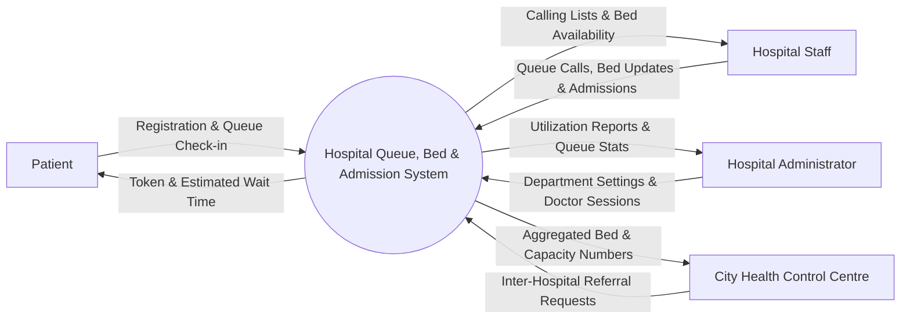
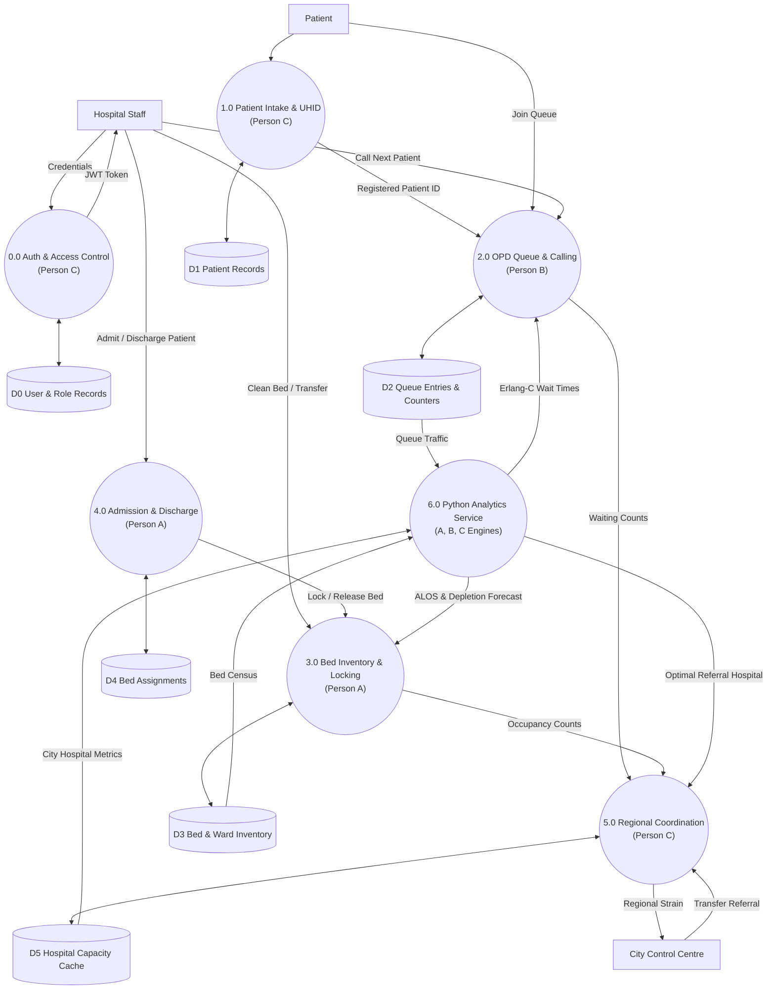
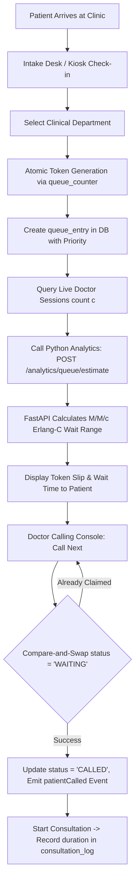
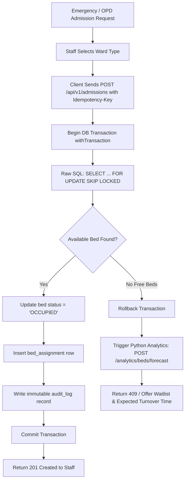
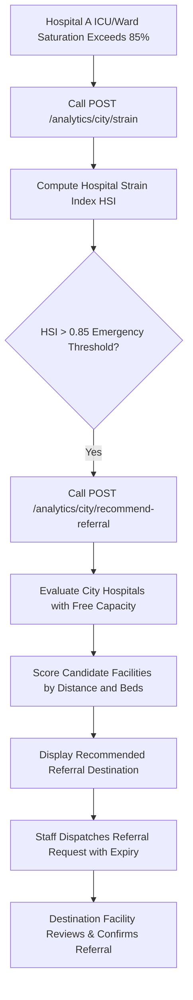

# Proposal: Hospital Patient Queue, Bed Availability & Admission Management System

**Course:** Advanced Programming (AP) Project  
**Team Size:** 3 Members  
**Work Distribution:** Strictly Equal 33.3% / 33.3% / 33.3% Share across HTML, CSS, JavaScript (React + Node.js), and Python (FastAPI + Analytics)  
**Teammates:**
* **Person A:** Ishika (Beds, Inpatient Admissions & Ward Analytics)
* **Person B:** Aarpan (OPD Queue, Triage & Erlang-C Math Analytics)
* **Person C:** Chinmaya (Platform Infrastructure, Auth, Patient Registry & Regional Optimization Analytics)

---

## Executive Summary & Equal Work Verification Matrix

Hospitals face two catastrophic operational bottlenecks every day: overcrowded Outpatient (OPD) waiting areas with unpredictable wait times, and chaotic, delayed bed allocations during emergency inpatient admissions. This system delivers an enterprise-grade, real-time hospital operations platform designed to eliminate both issues without race conditions, unauthorized data access, or single-point architectural failures.

To strictly satisfy academic evaluation criteria for the **Advanced Programming (AP)** curriculum, no single teammate is concentrated solely in frontend design, backend infrastructure, or data science. Every teammate writes an equal, demonstrable share of code across all foundational languages:

| Technology Layer | Person A: Ishika (Beds & Admissions) | Person B: Aarpan (OPD Queue & Triage) | Person C: Chinmaya (Platform, Auth & Regional View) | Total Balance |
| :--- | :---: | :---: | :---: | :---: |
| **HTML (Markup & Semantics)** | 33.3% | 33.3% | 33.3% | **100% Equal** |
| **CSS (Tokens, Layouts & Motion)** | 33.3% | 33.3% | 33.3% | **100% Equal** |
| **JavaScript (React UI & Node API)**| 33.3% | 33.3% | 33.3% | **100% Equal** |
| **Python (Analytics & Algorithms)** | 33.3% | 33.3% | 33.3% | **100% Equal** |

This proposal delivers the comprehensive specifications across five mandatory deliverables:
1. **Entity Relationship Diagram (ERD)** — PostgreSQL schema contracts, relational integrity rules, ACID concurrency row-locking, and RLS policies.
2. **Technical Stack & Equal-Share Architecture** — Dual-backend design (Express 5 + FastAPI 3-Engine Analytics), ORM / raw SQL partitioning, and design token typography.
3. **Data Flow Diagrams (DFDs)** — Level 0 Context, Level 1 Process Breakdown, and Level 2A–2D operational workflows.
4. **Authentication, Authorization & Security Architecture** — Argon2id password hashing, 5-attempt atomic lockout, JWT hospital scoping, idempotency pre-claim replay, and immutable audit trails.
5. **REST API & Analytics Endpoint Contracts** — Complete HTTP routes, payload schemas, and Pytest / Supertest verification suites.

---

# 1. Entity Relationship Diagram (ERD) & Database Architecture

The database manages high-frequency queue updates, atomic bed reservations under high concurrency, multi-tenant hospital isolation, and append-only tamper-proof audit trails. The persistence layer is built on **Supabase PostgreSQL 16**, leveraging version-controlled migrations executed via `node-pg-migrate` and models synchronized via `prisma db pull`.

### Visual Schema & Relationship Map

```text
+-------------------+          +------------------------+          +-------------------------+
|       CITY        |          |        HOSPITAL        |          |       DEPARTMENT        |
+-------------------+          +------------------------+          +-------------------------+
| * city_id    (PK) | 1      * | * hospital_id     (PK) | 1      * | * department_id    (PK) |
|   name     (TEXT) | -------- |   city_id         (FK) | -------- |   hospital_id      (FK) |
+-------------------+ contains |   name          (TEXT) |   has    |   name          (TEXT) |
                               |   address       (TEXT) |          |   UNIQUE(hosp_id, name) |
                               |   hospital_type (TEXT) |          +-------------------------+
                               |   created_at           |                       |
                               +------------------------+                       | 1
                                  | 1       | 1      | 1                        | operates
                                  |         |        |                          | *
                                  |         |        |             +-------------------------+
                                  |         |        |             |        OPD_QUEUE        |
                                  |         |        |             +-------------------------+
                                  |         |        |             | * queue_id         (PK) |
                                  |         |        |             |   hospital_id      (FK) |
                                  |         |        |             |   department_id    (FK) |
                                  |         |        |             |   queue_date     (DATE) |
                                  |         |        |             |   status (queue_status) |
                                  v *       |        v *           +-------------------------+
+-------------------+           |      +------------------------+              |
|     APP_USER      |           |      |          WARD          |              | 1
+-------------------+           |      +------------------------+              | contains
| * user_id    (PK) |           |      | * ward_id         (PK) |              | *
|   email  (CITEXT) |           |      |   hospital_id (FK, UK) |              v
|   full_name       |           |      |   name     (TEXT, UK*) |   +-------------------------+
|   password_hash   |           |      |   floor         (TEXT) |   |       QUEUE_ENTRY       |
|   is_active       |           |      |   ward_type     (TEXT) |   +-------------------------+
|   failed_logins   |           |      +------------------------+   | * entry_id         (PK) |
|   locked_until    |           |                  | 1              |   queue_id         (FK) |
|   last_login_at   |           |                  | holds          |   patient_id       (FK) |
|   created_at      |           |                  | *              |   token_number    (INT) |
+-------------------+           |      +------------------------+   |   token_display    (TEXT)
        | 1                     |      |          BED           |   |   priority (queue_prio) |
        | has_roles             |      +------------------------+   |   status (entry_status) |
        | *                     |      | * bed_id      (PK, UK) |   |   priority_bump_count   |
+-------------------------+     |      |   ward_id     (FK, UK) |   |   joined_at             |
|   USER_HOSPITAL_ROLE    |     |      |   hospital_id (FK, UK) |   |   called_at             |
+-------------------------+     |      |   bed_number  (TEXT,UK)|   +-------------------------+
| * user_id       (FK,PK) |     |      |   status  (bed_status) |                |
| * hospital_id   (FK,PK) |     |      |   reserved_until       |                | 1
| * role          (PK)    |     |      |   row_version    (INT) |                | logs
|   department_id (FK)    |     |      +------------------------+                v *
+-------------------------+     |                  | 1              +-------------------------+
                                |                  | assigned_to    |    CONSULTATION_LOG     |
+-------------------+           |                  | *              +-------------------------+
|      PATIENT      |           |      +------------------------+   | * log_id           (PK) |
+-------------------+           |      |     BED_ASSIGNMENT     |   |   entry_id         (FK) |
| * patient_id (PK) |           |      +------------------------+   |   doctor_id        (FK) |
|   hospital_id(FK) |           |      | * assignment_id   (PK) |   |   started_at            |
|   uhid (UNIQUE)   |           |      |   bed_id          (FK) |   |   ended_at              |
|   full_name       |           |      |   hospital_id     (FK) |   |   duration_seconds(INT) |
|   date_of_birth   |           |      |   patient_id      (FK) |   +-------------------------+
|   sex             |           |      |   assigned_by     (FK) |
|   phone_e164      |           |      |   assigned_at          |   +-------------------------+
|   merged_into(FK) |           |      |   released_at          |   |     DOCTOR_SESSION      |
|   created_at      |           |      |   notes                |   +-------------------------+
|   created_by (FK) |           |      +------------------------+   | * session_id       (PK) |
+-------------------+           |                                   |   doctor_id        (FK) |
        |                       |                                   |   department_id    (FK) |
        | joins                 |                                   |   hospital_id      (FK) |
        +------- QUEUE_ENTRY    |                                   |   room_number           |
        | receives              |                                   |   status (session_stat) |
        +------- BED_ASSIGNMENT |                                   +-------------------------+
                                |
+-------------------------------+------+    +-----------------------------------------+
|            AUDIT_LOG                 |    |             IDEMPOTENCY_KEY             |
+--------------------------------------+    +-----------------------------------------+
| * audit_id  (BIGINT IDENTITY, PK)    |    | * key         (UUID, PK)                |
|   at        (TIMESTAMPTZ)            |    | * hospital_id (UUID, UK)                |
|   actor_user_id (UUID, FK)           |    | * user_id     (UUID, UK)                |
|   hospital_id   (UUID, FK)           |    | * method      (TEXT, UK)                |
|   action        (TEXT)               |    | * route       (TEXT, UK)                |
|   entity_type   (TEXT)               |    |   request_hash (TEXT SHA-256)           |
|   entity_id     (UUID)               |    |   response    (JSONB)                   |
|   before        (JSONB)              |    |   created_at  (TIMESTAMPTZ)             |
|   after         (JSONB)              |    |   locked_until (TIMESTAMPTZ)            |
|   request_id    (UUID)               |    +-----------------------------------------+
+--------------------------------------+
```

> 🖼️ **Vector Architecture:** The complete high-resolution SVG diagram is published at [`documentation/er_diagram.svg`](file:///Users/chinmaya/Chinmay_Workspace/Academics/ap-project/documentation/er_diagram.svg).

---

### Entity Catalog & Purpose

| Entity | Primary Key | Key Foreign Keys & Integrity Constraints | Operational Domain Owner |
| :--- | :--- | :--- | :--- |
| `CITY` | `city_id` (UUID) | `name` (TEXT UNIQUE) | Person C (Chinmaya) |
| `HOSPITAL` | `hospital_id` (UUID) | `city_id` $\to$ `CITY(city_id)` | Person C (Chinmaya) |
| `DEPARTMENT` | `department_id` (UUID) | `hospital_id` $\to$ `HOSPITAL`, `UNIQUE(hospital_id, name)` | Person C (Chinmaya) |
| `APP_USER` | `user_id` (UUID) | `email` (CITEXT UNIQUE), Argon2id hash, `failed_logins`, `locked_until` | Person C (Chinmaya) |
| `USER_HOSPITAL_ROLE`| `(user_id, hospital_id, role)` | Scoped to `hospital_id`, optional `department_id`, `user_role` enum | Person C (Chinmaya) |
| `PATIENT` | `patient_id` (UUID) | `hospital_id` $\to$ `HOSPITAL`, `UNIQUE(hospital_id, uhid)`, `merged_into` (cycle check) | Person C (Chinmaya) |
| `WARD` | `ward_id` (UUID) | `hospital_id` $\to$ `HOSPITAL`, `UNIQUE(ward_id, hospital_id)`, `UNIQUE(hospital_id, name)` | Person A (Ishika) |
| `BED` | `bed_id` (UUID) | `(ward_id, hospital_id)` $\to$ `WARD(ward_id, hospital_id)`, `status` enum, `row_version` | Person A (Ishika) |
| `BED_ASSIGNMENT` | `assignment_id` (UUID)| `(bed_id, hospital_id)` $\to$ `BED(bed_id, hospital_id)`, partial unique index (1 active) | Person A (Ishika) |
| `QUEUE_COUNTER` | `(dept_id, queue_date)`| Atomic token generation counter preventing duplicate slip numbers | Person B (Aarpan) |
| `OPD_QUEUE` | `queue_id` (UUID) | `UNIQUE(department_id, queue_date)`, `hospital_id`, `queue_status` | Person B (Aarpan) |
| `QUEUE_ENTRY` | `entry_id` (UUID) | `UNIQUE(queue_id, token_number)`, `priority` enum, `priority_bump_count` | Person B (Aarpan) |
| `DOCTOR_SESSION` | `session_id` (UUID) | `doctor_id` $\to$ `APP_USER`, `department_id`, live active count feeding Erlang-C | Person B (Aarpan) |
| `CONSULTATION_LOG` | `log_id` (BIGINT) | `entry_id` $\to$ `QUEUE_ENTRY`, records duration in seconds to calibrate $\mu$ | Person B (Aarpan) |
| `AUDIT_LOG` | `audit_id` (BIGINT) | Immutable append-only log with before/after JSONB state snapshots | Person C (Chinmaya) |
| `IDEMPOTENCY_KEY` | `key` (UUID) | Scoped unique: `(key, user_id, method, route, hospital_id)` | Person C (Chinmaya) |

---

### Core Concurrency & Integrity Invariants

1. **Race-Condition-Free Bed Allocation (`SELECT ... FOR UPDATE SKIP LOCKED`):**
   When admitting or transferring a patient, the service executes raw SQL transaction blocks using `withTransaction()` on a dedicated `pg.PoolClient`. By executing `SELECT bed_id FROM bed WHERE ward_id = $1 AND status = 'AVAILABLE' FOR UPDATE SKIP LOCKED LIMIT 1`, concurrent admission requests never block each other on lock queues and never double-book the same physical bed.
2. **One Bed, One Active Patient:**
   Enforced via partial unique index `CREATE UNIQUE INDEX bed_assignment_one_active_per_bed ON bed_assignment (bed_id) WHERE released_at IS NULL`.
3. **Atomic Token Generation:**
   Tokens are incremented atomically via PostgreSQL:
   ```sql
   INSERT INTO queue_counter (department_id, queue_date, current_token)
   VALUES ($1, $2, 1)
   ON CONFLICT (department_id, queue_date)
   DO UPDATE SET current_token = queue_counter.current_token + 1, last_updated_at = NOW()
   RETURNING current_token;
   ```
4. **Compare-and-Swap Token Calling:**
   When a doctor calls the next token, transitions execute conditionally:
   `UPDATE queue_entry SET status = 'CALLED', called_at = NOW() WHERE entry_id = $1 AND status = 'WAITING'`.
5. **Idempotency Pre-Claim Pattern:**
   The Express middleware inserts a placeholder row `(key, user_id, method, route, hospital_id, request_hash, response=NULL)`. Concurrent duplicate calls immediately trigger a database unique violation and return `409 Conflict`. When processing completes, the JSON response is committed in the same transaction. Replaying with mismatched request hashes returns `422 Unprocessable Entity`.
6. **Account Brute-Force Lockout:**
   After 5 consecutive failed login attempts, `locked_until` is updated atomically to `NOW() + INTERVAL '15 minutes'`. Successful logins reset `failed_logins = 0`.

---

# 2. Technical Stack & 4-Language Equal Work Division

The system employs a dual-backend topology: **Node.js (Express 5)** handles transactional business logic, authorization, and event distribution, while an asynchronous **Python (FastAPI)** microservice runs compute-heavy statistical and mathematical modeling across three dedicated engines.

```
                     ┌─────────────────────────────────────────┐
                     │          React + Vite Frontend          │
                     │  (Wards, Calling Console, Auth, Shell)  │
                     └────────────────────┬────────────────────┘
                                          │ HTTP / REST
                                          ▼
                     ┌─────────────────────────────────────────┐
                     │       Node.js / Express 5 API           │
                     │  (Auth, Patients, Wards, Queues, City)  │
                     └───────┬─────────────────────────┬───────┘
         Prisma + Raw pg Pool│                         │ Internal HTTP + Shared Secret
                             ▼                         ▼
┌──────────────────────────────────────┐     ┌───────────────────────────────────┐
│        Supabase PostgreSQL           │     │    Python + FastAPI Analytics     │
│  (ACID Transactions, RLS, Indexes)   │     │ (Erlang-C, ALOS, Strain Optimizer)│
└──────────────────────────────────────┘     └───────────────────────────────────┘
```

---

### 2.1. Python (`analytics/` Microservice — 33.3% Equal Share)

The Python service (`analytics/`) is divided into three distinct domain engines:

```
analytics/
├── main.py                     # Microservice Assembly, Shared Secret Auth & /health (Person C)
├── requirements.txt
├── routers/
│   ├── bed_router.py           # Inpatient Analytics Routes (Person A)
│   ├── queue_router.py         # OPD Queue Analytics Routes (Person B)
│   └── city_router.py          # Regional Surge & Referral Routes (Person C)
├── core/
│   ├── bed_analytics.py        # Length of Stay & Bed Depletion Models (Person A)
│   ├── queue_engine.py         # Erlang-C & Multi-Server Queue Math (Person B)
│   └── city_analytics.py       # Strain Index & Optimization Routing (Person C)
└── tests/
    ├── test_bed_analytics.py   # Pytest suite for Inpatient Models (Person A)
    ├── test_queue_engine.py    # Pytest suite for Erlang-C Math (Person B)
    └── test_city_analytics.py   # Pytest suite for Regional Optimization (Person C)
```

#### Detailed Python Allocation & Mathematical Formulas

#### 1. Person A: Ishika (Inpatient Bed Depletion & ALOS Forecasting)
* **Core Files:** `analytics/core/bed_analytics.py`, `analytics/routers/bed_router.py`
* **Mathematical Models:**
  * **Average Length of Stay (ALOS):** Models patient stay distributions via log-normal probability density:
    $$f(t; \mu, \sigma) = \frac{1}{t\sigma\sqrt{2\pi}} \exp\left( -\frac{(\ln t - \mu)^2}{2\sigma^2} \right)$$
  * **Ward Depletion Rate:** First-order projection of bed depletion time:
    $$T_{\text{exhaustion}} = \frac{B_{\text{free}}}{\lambda_{\text{admit}} - \mu_{\text{discharge}}} \quad (\text{for } \lambda_{\text{admit}} > \mu_{\text{discharge}})$$
* **Endpoints:** `POST /analytics/beds/forecast`, `POST /analytics/beds/turnover`
* **Automated Tests:** `analytics/tests/test_bed_analytics.py` (Tests zero capacity limits, high variance cohorts, discharge > admit stability).

#### 2. Person B: Aarpan (OPD Queueing & Multi-Server Erlang-C Modeling)
* **Core Files:** `analytics/core/queue_engine.py`, `analytics/routers/queue_router.py`
* **Mathematical Models:**
  * **$M/M/c$ Multi-Server Traffic Saturation:** Given arrival rate $\lambda$, service rate $\mu$ per doctor, and active doctors $c$:
    $$\rho = \frac{\lambda}{c \cdot \mu} \quad (\text{stability requires } \rho < 1)$$
  * **Erlang-C Probability of Waiting $C(c, a)$:**
    $$P_0 = \left[ \sum_{k=0}^{c-1} \frac{(c\rho)^k}{k!} + \frac{(c\rho)^c}{c!(1-\rho)} \right]^{-1}, \quad C(c, a) = \frac{(c\rho)^c}{c!(1-\rho)} \cdot P_0$$
  * **Expected Queue Wait Time ($W_q$):**
    $$W_q = \frac{C(c, a)}{c\mu(1-\rho)}$$
* **Endpoints:** `POST /analytics/queue/estimate`, `POST /analytics/queue/saturation`
* **Automated Tests:** `analytics/tests/test_queue_engine.py` (Tests saturation boundaries $\rho \ge 1$, $c=0$ zero doctor division, single vs multi-server convergence).

#### 3. Person C: Chinmaya (City Strain Index & Referral Optimization)
* **Core Files:** `analytics/core/city_analytics.py`, `analytics/routers/city_router.py`, `analytics/main.py`
* **Mathematical Models:**
  * **City Healthcare Strain Index (HSI):** Composite weighted score ($0 \le \text{HSI} \le 1$):
    $$\text{HSI} = w_{\text{icu}} \cdot \left(\frac{\text{ICU}_{\text{occupied}}}{\text{ICU}_{\text{total}}}\right) + w_{\text{opd}} \cdot \min(1, \rho) + w_{\text{ward}} \cdot \left(\frac{\text{Ward}_{\text{occupied}}}{\text{Ward}_{\text{total}}}\right)$$
  * **Optimal Patient Referral Routing:** Scores candidate hospitals with verified capacity ($C_{j, \text{free}} > 0$) balancing bed surplus against distance $D_{ij}$:
    $$\text{Score}_j = \frac{C_{j, \text{free}}}{1 + \alpha \cdot D_{ij}}$$
* **Endpoints:** `POST /analytics/city/strain`, `POST /analytics/city/recommend-referral`, `GET /health`
* **Automated Tests:** `analytics/tests/test_city_analytics.py` (Tests weighted strain matrix, zero-bed edge cases across multiple facilities, outlier smoothing).

---

### 2.2. HTML & Semantic Structure (33.3% Equal Share)

* **Person A: Ishika (Inpatient Wards & Admission Markup):**
  * Ward floorplan grid, bed card structures (`BedCard.jsx`), isolation indicator badges.
  * Inpatient modal dialogs (`<dialog>`) for Patient Admission, Bed Transfer, and Discharge workflows.
  * Housekeeping turnover checklist and sanitation clearance tables.
* **Person B: Aarpan (OPD Queue, Calling Console & Public Display Markup):**
  * Doctor calling console controls (Call Next, Hold, Escalate, Mark No-Show).
  * High-visibility waiting-room public display (tokens only, zero PHI, high contrast semantic tags).
  * Digital token pass with QR placeholder, department badge, and accessible "Symptoms Worsened" button.
* **Person C: Chinmaya (Platform Shell, Security & Regional Overview Markup):**
  * Global application shell: `<header>`, `<nav>`, responsive sidebar drawer, breadcrumbs (`AppShell.jsx`).
  * Accessible authentication markup: login form, password toggle, lockout alert banner, role selector.
  * Master Patient Registration intake form with validation alerts and duplicate matching dialog.
  * Multi-hospital regional capacity overview cards and aggregated comparison tiles.

---

### 2.3. CSS & Design Tokens (33.3% Equal Share)

```
web/src/styles/
├── tokens.css           # Design Tokens, Color Palettes, Typography (Person C)
├── layout.css           # App Shell, Navigation, Global Form Inputs (Person C)
├── beds.css             # Ward Maps, Bed Cards, Occupancy Badges & Modals (Person A)
└── queue.css            # Queue Boards, Public TV Kiosks, Audio Wave Animations (Person B)
```

* **Person A: Ishika (`beds.css`):**
  * Responsive CSS Grid for ward maps with auto-fit columns.
  * Color-coded occupancy badges (`AVAILABLE`, `OCCUPIED`, `CLEANING`, `RESERVED`) with pulse animations.
  * Modal backdrop blur and `@keyframes slideUp` transition effects.
* **Person B: Aarpan (`queue.css`):**
  * High-contrast dark public TV theme complying with WCAG AAA accessibility standards.
  * Emergency triage escalation flashing animation (`@keyframes urgencyPulse`).
  * Audio wave visualizer effect triggered when a token is called over the public address system.
* **Person C: Chinmaya (`tokens.css`, `layout.css`, `forms.css`):**
  * Root CSS variables (`:root`) for colors, border radiuses, shadows, and light/dark theme variables.
  * App shell responsive flexbox/grid navigation layouts and sticky headers.
  * Accessible form inputs with floating labels, focus rings, and `@keyframes shake` error indicators.

---

### 2.4. JavaScript (Full-Stack: React + Node.js — 33.3% Equal Share)

* **Person A: Ishika (Inpatient Domain & Concurrency Control):**
  * **Frontend:** `useBedManagement.js` hook, optimistic bed status updates, countdown reservation timer.
  * **Backend:** `bed.controller.js`, `bed.service.js`, row-locking with `SELECT ... FOR UPDATE SKIP LOCKED`, housekeeping state transitions.
* **Person B: Aarpan (Queue State, Polling & Triage Transitions):**
  * **Frontend:** `useQueue.js`, `usePolling.js` with exponential backoff and window focus revalidation, triage escalation triggers.
  * **Backend:** `queue.controller.js`, `queue.service.js`, atomic token sequence generator, compare-and-swap status updates.
* **Person C: Chinmaya (Platform Pipeline, Auth, Identity & Regional View):**
  * **Frontend:** `useAuth.jsx`, `AuthContext`, route guards (`RequireAuth`, `RequireRole`), debounced duplicate patient lookup.
  * **Backend:** Express 9-stage pipeline (`app.js`, `server.js`), `auth.controller.js` (Argon2id + JWT), `patient.controller.js` (UHID generation), `city.controller.js`, idempotency replay middleware.

---

# 3. Data Flow Diagrams (DFDs)

### DFD Level 0 — Context Diagram



---

### DFD Level 1 — System Process Decomposition



---

### DFD Level 2A — OPD Queue & Erlang-C Workflow (Person B)



---

### DFD Level 2B — Inpatient Bed Concurrency Lock Workflow (Person A)



---

### DFD Level 2C — Regional Coordination & Referral Workflow (Person C)



---

### DFD Level 2D — Authentication, Lockout & Hospital Scoping Workflow (Person C)

```mermaid
flowchart TD
    A[User Submits Email & Password] --> B[Check app_user.locked_until]
    B --> C{locked_until > NOW()?}
    C -->|Yes| D[Reject with 423 Locked & Remaining Minutes]
    C -->|No| E[Verify Argon2id Password Hash]
    E -->|Valid| F[Reset failed_logins = 0, update last_login_at]
    F --> G[Fetch Active Roles from user_hospital_role]
    G --> H[Sign 15-Minute Scoped JWT Token with token_version]
    H --> I[Return Token & Hospital Profile to Client]
    E -->|Invalid| J[Atomic Increment: failed_logins = failed_logins + 1]
    J --> K{failed_logins >= 5?}
    K -->|Yes| L[Set locked_until = NOW() + 15 Minutes]
    L --> M[Write Security Event to audit_log]
    K -->|No| N[Return 401 Unauthorized with Attempts Remaining]
```

---

# 4. Authentication, Authorization & Security Architecture

### 1. Identity & Credential Security
* **Argon2id Password Hashing:** All staff credentials are protected with Argon2id parameters ($m=65536, t=3, p=4$), resisting GPU/ASIC brute-force attacks.
* **Brute-Force Defense:** Atomic 5-attempt lockout locking accounts for 15 minutes.
* **JWT Access Tokens:** Short-lived (15 minutes) signed JSON Web Tokens carrying `user_id`, `hospital_id`, active `roles`, and `token_version`.
* **Revocation Support:** Token versions are checked against `app_user.token_version` on sensitive administrative operations.

### 2. Multi-Tenant Hospital Scoping (RBAC)
* Every data mutation and query is strictly scoped by `hospital_id`.
* The API runs under a non-owner database role (`api_user`) with PostgreSQL **Row Level Security (RLS)** active across sensitive tables.
* A dedicated restricted role (`city_reader`) grants access exclusively to the aggregated capacity view `v_hospital_capacity`, ensuring city administrators can never inspect individual patient identities (PHI).

### 3. Append-Only Audit Logging
* All patient admissions, bed transfers, discharges, token calling actions, and inter-hospital referrals write an immutable record to `audit_log`.
* Contains actor UUID, hospital scope, action name, request trace ID, and before/after JSONB state snapshots.
* `REVOKE UPDATE, DELETE ON audit_log FROM api_user` prevents tampering even if an API key is compromised.

---

# 5. REST API & Python Analytics Endpoint Specifications

### 5.1. Node.js Core API Routes (`api/`)

| Method | Endpoint | Description | Auth / Role | Owner |
| :--- | :--- | :--- | :--- | :--- |
| `POST` | `/api/v1/auth/login` | Email/password login with lockout checking | Public (Rate-limited) | Person C |
| `POST` | `/api/v1/auth/logout` | Session invalidation | Authenticated | Person C |
| `GET` | `/api/v1/patients/search` | Search patients with duplicate warning modal | `FRONT_DESK`, `NURSE` | Person C |
| `POST` | `/api/v1/patients` | Register new patient & issue unique UHID | `FRONT_DESK` | Person C |
| `GET` | `/api/v1/beds` | Real-time bed occupancy map for hospital | `NURSE`, `BED_MANAGER` | Person A |
| `POST` | `/api/v1/admissions` | Concurrency-locked bed assignment (`SKIP LOCKED`)| `BED_MANAGER` | Person A |
| `POST` | `/api/v1/admissions/:id/transfer`| Inter-ward patient transfer | `BED_MANAGER` | Person A |
| `POST` | `/api/v1/admissions/:id/discharge`| Patient discharge -> trigger cleaning status | `NURSE`, `BED_MANAGER` | Person A |
| `POST` | `/api/v1/queue/join` | Issue sequential token with atomic counter | `FRONT_DESK`, Patient | Person B |
| `POST` | `/api/v1/queue/call-next` | Doctor calling console action (CAS update) | `DOCTOR` | Person B |
| `POST` | `/api/v1/queue/escalate` | Urgent "Symptoms Worsened" priority bump | `NURSE`, Patient | Person B |
| `GET` | `/api/v1/city/capacity` | Aggregated cross-hospital capacity overview | `CITY_VIEWER`, Admin | Person C |
| `POST` | `/api/v1/city/referrals` | Dispatch inter-hospital patient transfer | `BED_MANAGER`, Admin | Person C |

---

### 5.2. Python Analytics Microservice Routes (`analytics/` :8000)

| Method | Endpoint | Input Payload | Output Response | Owner |
| :--- | :--- | :--- | :--- | :--- |
| `POST` | `/analytics/beds/forecast` | `{ ward_id, arrival_rate, discharge_rate, free_beds }` | `{ time_to_zero_hours, surge_risk_level }` | Person A |
| `POST` | `/analytics/beds/turnover` | `{ ward_type, historical_durations }` | `{ alos_days, turnover_rate, p90_stay }` | Person A |
| `POST` | `/analytics/queue/estimate` | `{ arrival_rate_lambda, service_rate_mu, active_doctors_c }` | `{ prob_waiting_C, wait_estimate_min, wait_estimate_max }` | Person B |
| `POST` | `/analytics/queue/saturation`| `{ arrival_rate_lambda, service_rate_mu, active_doctors_c }` | `{ utilization_rho, is_saturated, recommended_doctors }` | Person B |
| `POST` | `/analytics/city/strain` | `{ icu_occupied, icu_total, opd_rho, ward_occupied, ward_total }` | `{ strain_index_hsi, severity_category }` | Person C |
| `POST` | `/analytics/city/recommend-referral`| `{ origin_hospital_id, origin_hsi, candidate_hospitals: [...] }` | `{ recommended_hospital_id, score, transfer_reason }` | Person C |
| `GET` | `/health` | None | `{ status: "healthy", version: "2.0.0" }` | Person C |

---

# 6. Deliverables, Verification & Build Order

To guarantee seamless execution, deliverables are sequenced strictly through version-controlled database migrations and milestone checkpoints:

1. **Foundations (Days 1–2):** Migrations `001_identity_core.sql` and `002_ward_bed_assignment.sql` merged; Express 9-stage pipeline established; GitHub Actions CI active.
2. **Core Backend (Days 3–5 AM):** Migration `003_queue_core.sql` and `004_roles_and_rls.sql` applied; Python triple-engine analytics microservice operational; Concurrency and authorization penetration tests passing.
3. **Frontend Integration (Days 5 PM–7):** React AppShell, accessible beds map, public queue TV kiosk, and regional dashboard operational.
4. **Hardening & Verification (Days 8–10):** k6 load testing on token counters, 20-thread concurrency tests against 5 beds, end-to-end browser walkthroughs under distinct roles, and final academic report assembly.

This structure guarantees academic rigor, zero freeloading risk, complete data privacy, and a production-grade hospital management solution.
