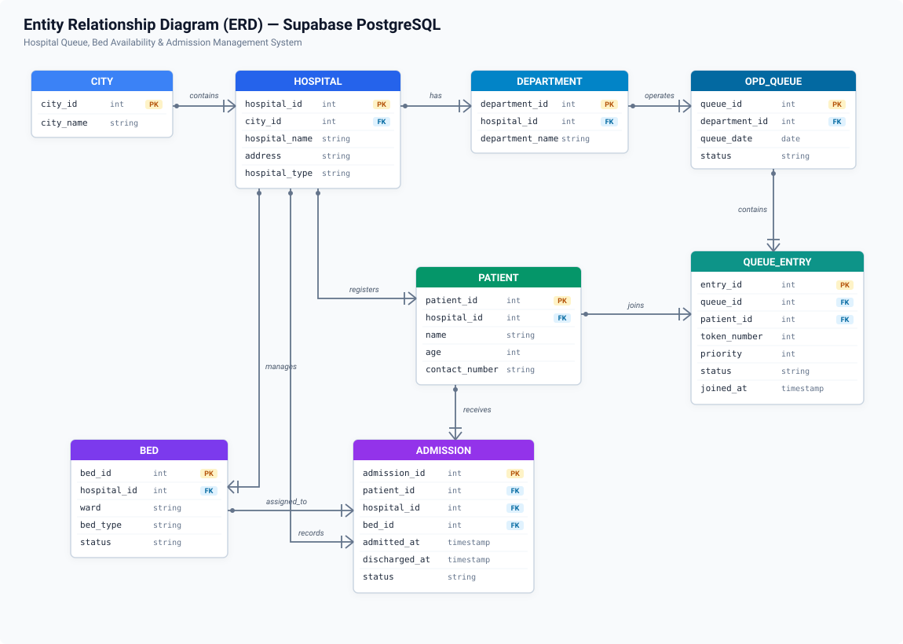
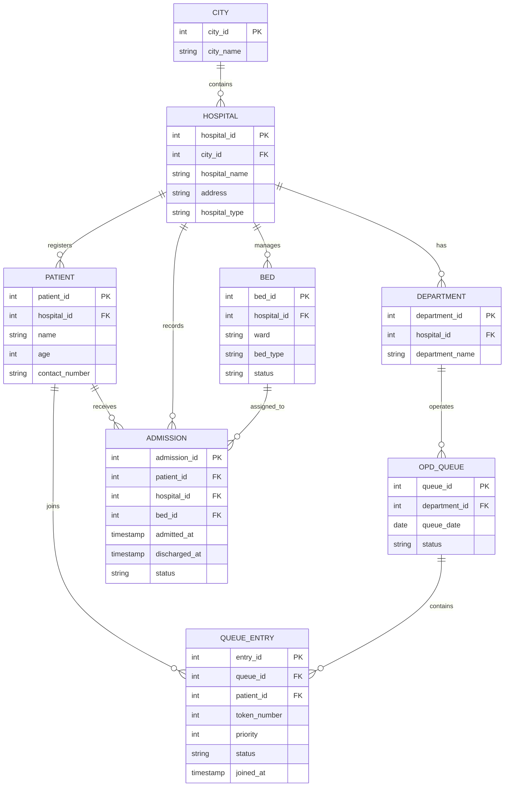
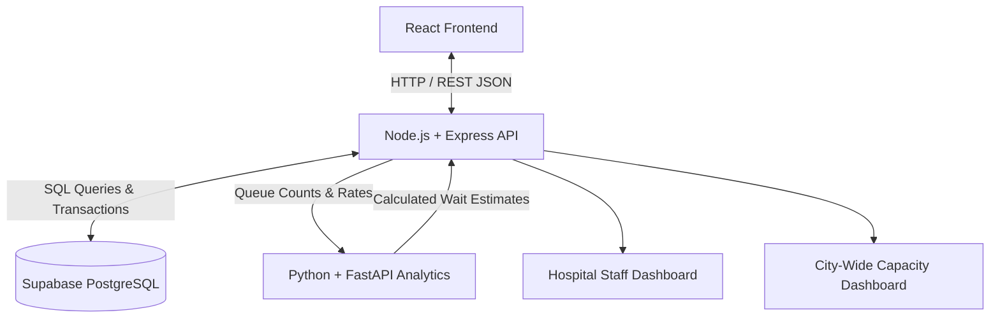
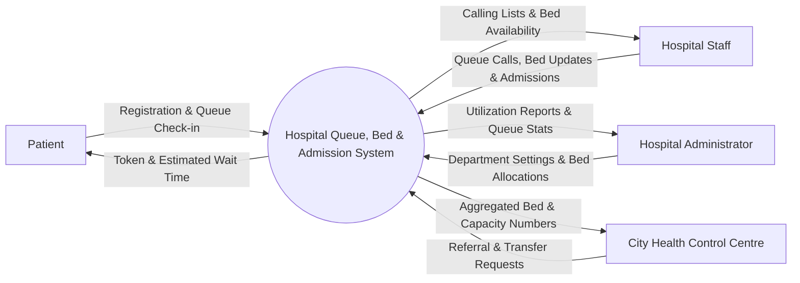
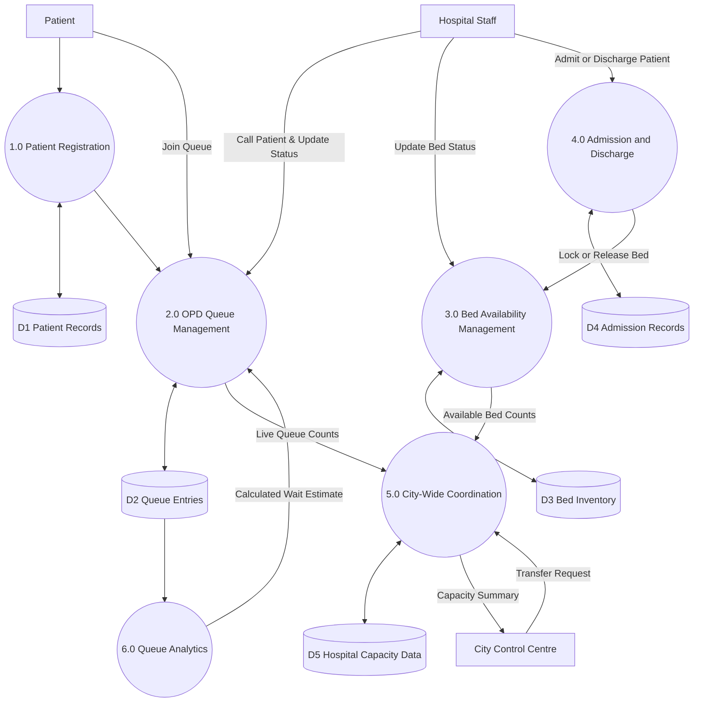
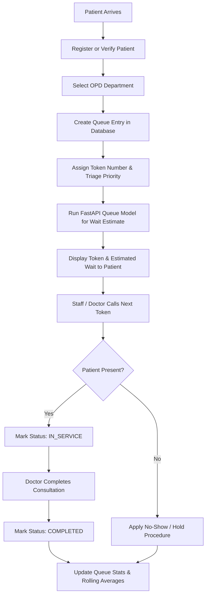
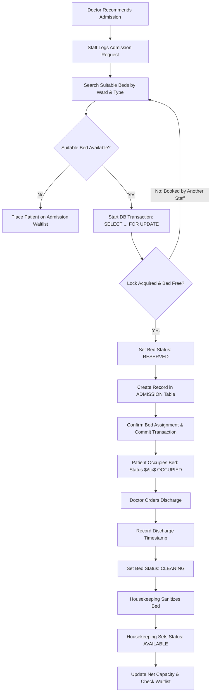
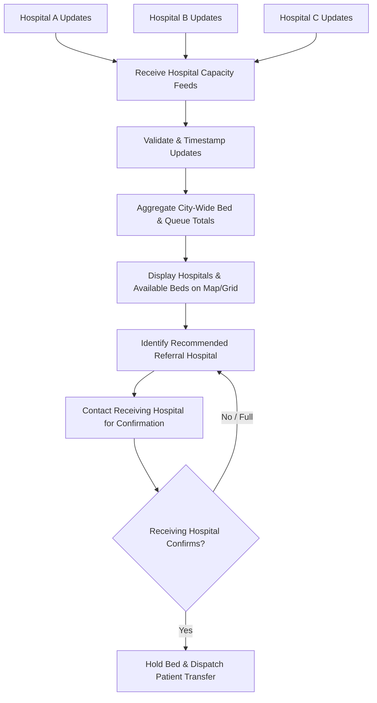

# Proposal: Hospital Patient Queue, Bed Availability & Admission Management System

## Project Overview

Hospitals deal with two major operational headaches every day: overcrowded OPD waiting areas and chaotic, delayed bed allocations during admissions. This proposal outlines a practical, real-time management system designed to tackle both issues head-on.

The system manages outpatient (OPD) queues, tracks live bed availability, and handles patient admissions and discharges. It is designed to work smoothly within a single hospital first, while having the architecture ready to expand into a city-wide coordination dashboard where multiple hospitals can view each other's live capacity.

This proposal provides the three requested deliverables:

1. **ER diagram for the solution** — the relational data model, entity breakdown, and integrity rules.
2. **Tech stack** — the frameworks and databases to be used, including system communication and queueing calculations.
3. **Data flow diagrams (DFDs)** — context (Level 0), system decomposition (Level 1), and detailed operational workflows (Level 2).

The proposed stack uses **React, JavaScript, HTML, CSS, Node.js, Python, and Supabase PostgreSQL**.

---

# 1. ER Diagram for the Solution

The database needs to handle high-frequency queue updates and strict, race-condition-free bed assignments. We use **Supabase PostgreSQL** as our relational database because we need ACID transactions and foreign-key constraints to guarantee that a bed is never double-booked.

### Entity Relationship Diagram



#### Visual Schema & Relationship Map (Universal Text View)

```text
+-------------------+          +------------------------+          +-------------------------+
|       CITY        |          |        HOSPITAL        |          |       DEPARTMENT        |
+-------------------+          +------------------------+          +-------------------------+
| * city_id    (PK) | 1      * | * hospital_id     (PK) | 1      * | * department_id    (PK) |
|   city_name       | -------- |   city_id         (FK) | -------- |   hospital_id      (FK) |
+-------------------+ contains |   hospital_name        |   has    |   department_name       |
                               |   address              |          +-------------------------+
                               |   hospital_type        |                       |
                               +------------------------+                       | 1
                                  | 1                | 1                        | operates
                                  | registers        | manages                  | *
                                  |                  |             +-------------------------+
                                  |                  |             |        OPD_QUEUE        |
                                  |                  |             +-------------------------+
                                  |                  |             | * queue_id         (PK) |
                                  |                  |             |   department_id    (FK) |
                                  |                  |             |   queue_date            |
                                  v *                v *           |   status                |
+-------------------+          +------------------------+          +-------------------------+
|      PATIENT      |          |          BED           |                       |
+-------------------+          +------------------------+                       | 1
| * patient_id (PK) |          | * bed_id          (PK) |                       | contains
|   hospital_id(FK) |          |   hospital_id     (FK) |                       | *
|   name            |          |   ward                 |                       v
|   age             |          |   bed_type             |          +-------------------------+
|   contact_number  |          |   status               |          |       QUEUE_ENTRY       |
+-------------------+          +------------------------+          +-------------------------+
   | 1           | 1                     | 1                       | * entry_id         (PK) |
   | joins       | receives              | assigned_to             |   queue_id         (FK) |
   |             |                       |                         |   patient_id       (FK) |
   |             v *                     v *                       |   token_number          |
   |          +-------------------------------------+              |   priority              |
   |          |              ADMISSION              |              |   status                |
   |          +-------------------------------------+              |   joined_at             |
   |          | * admission_id                 (PK) |              +-------------------------+
   |          |   patient_id                   (FK) |                           ^
   |          |   hospital_id                  (FK) |                           | *
   |          |   bed_id                       (FK) |                           | joins
   |          |   admitted_at                       | --------------------------+
   |          |   discharged_at                     | 1
   |          |   status                            |
   |          +-------------------------------------+
```

#### Mermaid Source Code (for Mermaid-enabled viewers)



### Entities and Their Purpose

| Entity | Purpose |
| :--- | :--- |
| `CITY` | Groups hospitals under a regional or city-wide umbrella for coordinated capacity viewing. |
| `HOSPITAL` | Stores essential hospital information such as name, address, and facility type. |
| `DEPARTMENT` | Represents clinical departments (e.g., General Medicine, Cardiology, Orthopaedics) that run outpatient queues. |
| `PATIENT` | Master patient record containing registration details, contact numbers, and demographics. |
| `OPD_QUEUE` | Represents an active queue session for a specific department on a given day. |
| `QUEUE_ENTRY` | Tracks individual patient tokens, triage priority, check-in timestamps, and queue status. |
| `BED` | Physical bed registry detailing ward, bed category (General, ICU, Step-down), and current status. |
| `ADMISSION` | Inpatient records linking a patient to an allocated bed, tracking admission and discharge times. |

### Key Database & Business Rules

* **One bed, one active patient:** A bed can have many historical admissions over time, but it must never have two active occupants at the same time.
* **Explicit bed status progression:** Bed status must move through distinct states: `AVAILABLE` $\to$ `RESERVED` $\to$ `OCCUPIED` $\to$ `CLEANING` $\to$ `AVAILABLE` (with `OUT_OF_SERVICE` for maintenance). A discharged bed cannot be marked available until housekeeping confirms it has been sanitized.
* **Deterministic queue states:** Queue entries must follow clear transitions: `WAITING` $\to$ `CALLED` $\to$ `IN_SERVICE` $\to$ `COMPLETED` (or `CANCELLED` if the patient leaves or doesn't show up).
* **Concurrency protection:** When reserving a bed, the backend uses atomic database transactions with row-level locks (`SELECT ... FOR UPDATE`) so two staff members cannot assign the same bed simultaneously.
* **City-wide data boundary:** In city-wide mode, each hospital maintains full ownership of its operational records. The city module only reads aggregated capacity and average wait times, never raw private patient records.
* **Bilateral transfer confirmation:** The city dashboard displays estimated bed availability, but an inter-hospital transfer cannot be confirmed until the receiving facility explicitly accepts the referral.

---

# 2. Tech Stack — Frameworks and DBs to be Used

We chose a practical dual-backend architecture: **Node.js/Express** handles core business logic and database transactions, while **Python/FastAPI** is dedicated to queueing calculations and analytics. This keeps day-to-day operations fast and isolates heavier statistical math from the main API.

### Technology Choices

* **Frontend: React + JavaScript + HTML + CSS**
  * Builds the responsive patient token screen, doctor calling console, ward bed management view, and the city-wide capacity dashboard.
  * React makes it easy to update queue numbers and bed status badges instantly without page reloads.

* **Main Backend: Node.js + Express**
  * Handles patient registrations, OPD token generation, queue status updates, admissions, discharges, and bed state updates.
  * Express is lightweight, fast with asynchronous I/O, and interacts directly with PostgreSQL using standard database connection pooling (`pg`).

* **Analytics Backend: Python + FastAPI**
  * Handles wait-time calculations, multi-server queue modeling ($M/M/c$), clinic demand trends, and capacity simulations.
  * Python makes mathematical calculations straightforward, and FastAPI provides an ultra-fast, clean REST API that Express can call asynchronously.

* **Database: Supabase PostgreSQL**
  * Houses all data: hospital profiles, departments, patients, queue entries, beds, and admission records.
  * Gives us ACID transaction guarantees, solid indexing, Row Level Security (RLS), and optional real-time event subscriptions without the burden of self-hosting a database instance.

### System Communication Flow



In this setup:
1. The React frontend speaks exclusively to the Node.js API.
2. Node.js executes operational updates against Supabase PostgreSQL.
3. When wait-time predictions are needed, Node.js passes current queue metrics to FastAPI and receives estimated waiting times back.
4. Both hospital-level and city-level dashboards receive clean, processed data from the Express backend.

### Recommended Libraries & Tooling

| Component | Technology | Rationale |
| :--- | :--- | :--- |
| **Frontend** | React, JavaScript, CSS | Reusable components, fast DOM updates, clean UI for dashboards. |
| **Core API** | Node.js, Express | Fast asynchronous I/O, simple route handlers, solid middleware ecosystem. |
| **Analytics API** | Python, FastAPI | Ideal for mathematical modeling, fast execution, automatic API docs. |
| **Database** | Supabase PostgreSQL | Strong relational integrity, ACID compliance, zero maintenance overhead. |
| **Database Driver** | `pg` (node-postgres) | Native PostgreSQL connection pooling and reliable transaction control. |
| **API Testing** | Postman / curl | Easy endpoint testing and request verification. |
| **Version Control** | Git & GitHub | Standard source control and team collaboration. |
| **Math Modeling** | Python `math` (NumPy optional) | Calculating Erlang-C and multi-server queue formulas. |

> **A note on simplicity:** We deliberately do not include Redis, Kafka, or Docker for the initial system. Node.js combined with well-indexed PostgreSQL tables is more than fast enough for a single hospital or a simulated multi-hospital prototype. We can add caching or message brokers later if load demands it.

### Queueing Model ($M/M/c$)

Rather than giving patients rough, static estimates (like multiplying remaining tokens by an arbitrary 10 minutes), the Python service implements an **$M/M/c$ multi-server queueing model**:
* Arrivals follow a Poisson process with average arrival rate $\lambda$ (patients arriving per hour).
* Doctor consultation times follow an exponential distribution with average service rate $\mu$ (patients seen per hour per doctor).
* $c$ represents the number of doctors actively taking patients in that department.

The utilization rate $\rho$ is calculated as:

$$\rho = \frac{\lambda}{c \cdot \mu}$$

For a queue to stay stable and avoid backing up indefinitely, utilization must remain under 1 ($\rho < 1$). If $\rho \ge 1$, the clinic is falling behind, and the system can notify staff that another doctor is needed.

To project expected wait times, the service calculates the probability that an arriving patient has to wait using the **Erlang-C formula**:

$$P_0 = \left[ \sum_{n=0}^{c-1} \frac{(c\rho)^n}{n!} + \frac{(c\rho)^c}{c!(1-\rho)} \right]^{-1}$$

$$P_Q = \frac{\frac{(c\rho)^c}{c!(1-\rho)} \cdot P_0}{1}$$

The expected waiting time in the queue ($W_q$) is then:

$$W_q = \frac{P_Q}{c\mu(1-\rho)}$$

In practice, these formulas give a solid baseline that we refine with a 30-to-60 minute rolling average of actual consultation times as the day progresses.

---

# 3. Data Flow Diagrams (DFDs)

While the ER diagram shows how data is stored, Data Flow Diagrams (DFDs) show how data moves through the system between users, processes, and tables.

### DFD Level 0 — Context Diagram

The context diagram treats the entire platform as a single system and shows who interacts with it.



* **Patient:** Registers, joins a queue, and checks their token status and wait time.
* **Hospital staff:** Call next patients, update bed statuses (e.g., mark cleaned), and record admissions and discharges.
* **Hospital administrator:** Configures departments, checks doctor counts, and reviews occupancy and wait-time reports.
* **City health control centre:** Monitors live bed availability across facilities to coordinate emergency patient transfers.

---

### DFD Level 1 — Main System Processes

This diagram breaks the system down into its six main functional processes and five logical data stores.



#### What the Data Stores Represent

| Data Store | Information Stored |
| :--- | :--- |
| **D1: Patient Records** | Demographics, contact info, and patient ID numbers. |
| **D2: Queue Entries** | Daily tokens, triage priority, check-in timestamps, and queue statuses. |
| **D3: Bed Inventory** | Ward details, bed categories, current operational status, and hospital ID. |
| **D4: Admission Records** | Active and past hospital stays, assigned bed IDs, and admission/discharge times. |
| **D5: Hospital Capacity Data** | Aggregated bed counts and departmental waiting times for city-wide reporting. |

*(Note: D1 through D5 are tables within the same Supabase PostgreSQL database, not five separate database engines).*

---

### DFD Level 2A — OPD Queue Management Workflow

This diagram maps out how an outpatient moves from arrival to completing their doctor visit.



**Clinical Safety Rule:** Outpatient queues are strictly for routine, non-emergency consultations. Any patient presenting with red-flag emergency symptoms must immediately bypass the OPD queue and be routed straight to emergency triage.

---

### DFD Level 2B — Bed Availability & Inpatient Admission

This diagram shows how beds are searched, locked, assigned, and eventually cleaned and returned to service.



**Preventing Double-Booking:** The critical step is `SELECT ... FOR UPDATE` inside an explicit database transaction. If two staff members try to allocate the same bed at the exact same moment, one transaction will lock the row while the other waits and safely re-checks availability.

---

### DFD Level 2C — City-Wide Coordination

This diagram shows how multiple hospitals share capacity data and coordinate patient transfers.



For the initial prototype, Hospitals A, B, and C can simply be separate hospital records in the same Supabase database. This lets us fully demonstrate the multi-hospital dashboard without having to connect multiple physical hospital networks on day one.

---

# Summary of Deliverables & Implementation Plan

### Deliverables Matrix

| Deliverable | What We Are Delivering | Key Benefit |
| :--- | :--- | :--- |
| **1. ER Diagram** | 8 core entities covering cities, hospitals, departments, patients, queues, beds, and admissions. | Clean data structure that stops duplicate bed assignments and keeps patient history intact. |
| **2. Tech Stack** | React (Frontend), Node.js + Express (Core API), Python + FastAPI (Queue Analytics), Supabase PostgreSQL (Database). | Fast daily transactions, scientific wait-time calculations, and reliable data storage with minimal setup. |
| **3. Data Flow Diagrams** | Context (Level 0), System Processes (Level 1), OPD Queue (Level 2A), Bed Admission (Level 2B), and City Coordination (Level 2C). | Clear operational guide showing exactly how data enters, moves through, and updates across the system. |

### Suggested Build Order

1. **Database Schema:** Set up the tables, foreign keys, enums, and check constraints in Supabase.
2. **Core API:** Build the Node.js/Express endpoints for patient intake and bed management with transaction locks.
3. **Queue Operations:** Implement token generation, calling sequences, and status updates.
4. **Analytics Service:** Build the FastAPI service with the $M/M/c$ and Erlang-C waiting time formulas.
5. **Frontend Screens:** Build the React interfaces (patient token screen, staff queue board, and ward bed map).
6. **City-Wide View:** Add simulated hospital entries to verify cross-facility capacity reporting.
7. **Testing:** Run concurrency tests on bed booking, verify no-show handling, and calibrate wait-time math against sample clinic data.

**Privacy Note:** We will use fake, synthetic patient data during development. Before connecting to any real patient data, the system will have full authentication, role-based access controls (RBAC), Row Level Security (RLS) on database tables, and proper healthcare data privacy safeguards.
